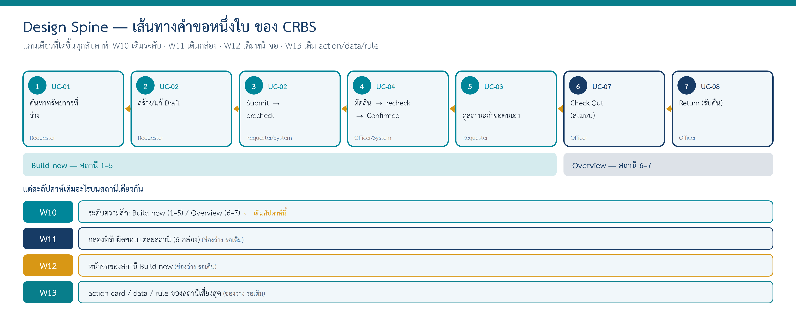

# Design Spine — เส้นทางงานหลักหนึ่งชิ้นของ CRBS (เส้นทางคำขอหนึ่งใบ)

> ตารางนี้โตขึ้นทุกสัปดาห์: W10 เติมคอลัมน์ "W10 ระดับ"; W11 เติม "กล่อง"; W12 เติม "หน้าจอ"; W13 เติม "action/data/rule"
> แถว = ขั้นที่ผู้ใช้/ระบบทำจริงตามลำดับ 5–8 แถว จาก Core use case ใน `docs/06-requirement-models.md`
> ระดับ: **Build now** = Dev เริ่มเขียนได้หลัง W13 | **Overview** = อยู่ในภาพรวม/ข้อมูล/กติกา ยังไม่มีหน้าจอ-contract ละเอียด | **Later** = increment ถัดไป

แกนของ CRBS คือ **"คำขอหนึ่งใบ"** — ผู้ใช้หนึ่งคนขอใช้ห้อง/อุปกรณ์หนึ่งครั้ง ตั้งแต่ค้นหาจนคืนของ เส้นนี้ร้อยทุกส่วนของระบบเข้าด้วยกัน W10 เติมคอลัมน์ "W10 ระดับ" · W11 เติมคอลัมน์ "W11 กล่องที่รับผิดชอบ" (= "W11 เดินผ่าน container" ในหัวข้อ 7 ของ `design/11-conceptual-architecture-v0.1.docx`) · คอลัมน์ W12–W13 ยังว่าง

> W11: Web = Web Application · API = API Application · Database = Database ตาม [container diagram](../diagrams/architecture/11-container.png) — ทุกขั้นเดินเส้นเดียวกัน Web → API → Database และกติกา D1–D3 ถูกตรวจที่ API (DEC-01)

| # | ขั้นในเส้นทาง | Actor | UC | AC หลัก | W10 ระดับ | W11 กล่องที่รับผิดชอบ | W12 หน้าจอ | W13 action / data / rule |
|---|---|---|---|---|---|---|---|---|
| 1 | ค้นหาทรัพยากรที่ว่างตามประเภท/วัน/เวลา | Requester | UC-01 | AC-01–04 | Build now | Web → API (นับเฉพาะ Confirmed + block) → Database | | |
| 2 | สร้าง/แก้ Draft (ยังไม่กันทรัพยากร) | Requester | UC-02 | AC-08 | Build now | Web → API → Database | | |
| 3 | Submit → ตรวจข้อมูลขั้นต่ำ → Submitted + เลขอ้างอิง → precheck | Requester / System | UC-02 | AC-05, AC-06, AC-07 | Build now | Web → API (precheck · ออกเลขอ้างอิง) → Database | | |
| 4 | Officer เปิดคำขอ ตรวจ ตัดสิน → recheck → Confirmed / Rejected / Needs Information | Officer / System | UC-04 | AC-09–12 | Build now | Web (Officer) → API (recheck + เปลี่ยน state + audit ใน transaction เดียว) → Database | | |
| 5 | Requester ดูสถานะ/ประวัติคำขอตนเอง และได้รับแจ้งเมื่อตัดสิน | Requester | UC-03 | (Partial — OI-07) | Build now (ดูอย่างเดียว) | Web → API (เฉพาะคำขอของตน — NFR-02) → Database | | |
| 6 | Check Out: บันทึก responsible requester + due time | Officer | UC-07 | AC-17–20 | Overview | Web (Officer) → API → Database | | |
| 7 | Return: บันทึก returned time + condition summary | Officer | UC-08 | AC-21–24 | Overview | Web (Officer) → API → Database | | |
| ทุกแถว | สิทธิ์ + audit (cross-cutting) | — | — | — | Build now (cross-cutting) | ตรวจสิทธิ์ที่ API ทุก action · AuditEvent ลง Database | | |

> แถว 5: UC-03 ยังไม่มี AC ละเอียดใน SRS — เป็น OI-07 (Detailed flows/AC สำหรับ UC-03/06/09/10 · เจ้าของ Requirements team) จึงเขียน "(Partial — OI-07)" แทนการแต่ง AC ใหม่

ต้นฉบับภาพ: [`diagrams/design-strategy/10-design-spine.drawio`](../diagrams/design-strategy/10-design-spine.drawio)

## บันทึกการเปลี่ยนแปลง

| สัปดาห์ | เปลี่ยนอะไร | เพราะ |
|---|---|---|
| W10 | สร้างครั้งแรก: 7 แถว เติมคอลัมน์ "W10 ระดับ" (ขั้น 1–5 Build now · ขั้น 6–7 Overview) | ใช้ "คำขอหนึ่งใบ" เป็นแกน เพราะร้อยทุกส่วนของระบบ — ขั้นมาจาก Core use case ใน `docs/06-requirement-models.md` (UC-01, UC-02, UC-04, UC-03, UC-07, UC-08) |
| W10 | เพิ่มหมายเหตุใต้ตารางเรื่อง AC ของแถว 5 (ไม่เปลี่ยนค่าในตาราง) | คู่ review บน Miro แปะ sticky "spine ขั้น 5 ยังไม่ใส่ AC" — AC ของ UC-03 รอ OI-07 จึงไม่เพิ่ม AC เอง |
| W11 | เติมคอลัมน์ "W11 กล่องที่รับผิดชอบ" ทั้ง 7 แถว + เพิ่มแถว "ทุกแถว" (สิทธิ์ + audit) | ให้ตรงหัวข้อ 7 ของไฟล์ Word W11 · ภาพ Spine ของ W10 คาดว่า W11 จะเติม "6 กล่อง" แต่ที่ระดับ container มี 3 ชิ้น (Web · API · Database) — หน้าที่ของกล่องตามชื่อใน W10 (เช่น Validation & Conflict) อยู่ใน API Application และจะซูมเป็น component ใน W13 |
