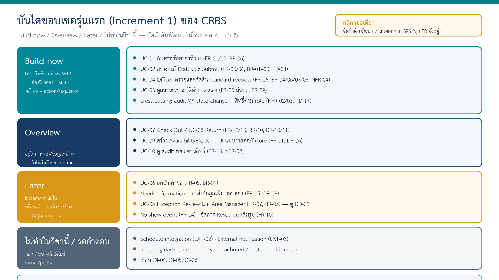

# Design Strategy v0.1 — CRBS (Campus Resource Booking System)

> **สถานะ:** Design Draft | **Assignment:** W10-v1.0 | **Case:** Case X — CRBS ระบบจองพื้นที่ทำงานกลุ่มและอุปกรณ์การเรียนรู้ (กรณีสอนของผู้สอน ไม่ใช่นโยบายจริงของมหาวิทยาลัย)
> **ฐาน SRS ที่ใช้:** `docs/07-srs-v1.md` (`CRBS-SRS-W07-v1.1`) สถานะ Baseline Candidate — not approved baseline; Open Issues OI-01–OI-08 ยังเปิด — *ไม่อ้างว่า Approved*
> **Change request ที่รู้และยัง Pending:** `CR-01-SIM` ("Submit แล้วกันทรัพยากรทันที") — สถานการณ์สมมติสำหรับฝึก สถานะ Pending **ไม่นำมาใช้ในแบบนี้**

## 1. ระบบนี้ทำอะไร (ไม่เกิน 4 บรรทัด สำหรับ Dev)

Requester ค้นหาห้อง/อุปกรณ์ที่ว่าง สร้างคำขอแล้ว Submit → Resource Officer ตรวจและตัดสิน → เฉพาะคำขอที่ **Confirmed** เท่านั้นที่กันทรัพยากร → อุปกรณ์ที่ต้องส่งมอบมีการบันทึก Check Out และ Return แยกจากสถานะคำขอ → ทุกการเปลี่ยนสถานะและการตัดสินมี audit

ผู้ใช้หลัก: Student Requester (ACT-01), Resource Officer (ACT-02), Area Manager (ACT-03 — เฉพาะ exception), System Administrator (ACT-04 — role mapping)

SRS (15 FR · 10 BR · 8 NFR · 13 DR) บอกครบว่าระบบต้องทำอะไร แต่ยังไม่บอกว่าเริ่มอันไหนก่อน ตรงไหนพลาดแล้วพังทั้งใบ และเรื่องที่ยังไม่รู้ (OI-01–08) จะทำยังไงระหว่างรอ — เอกสารนี้ตอบ 3 เรื่องนั้น: Scope (หัวข้อ 2) · Drivers (หัวข้อ 3) · Spine (หัวข้อ 4)

## 2. ขอบเขตรุ่นแรก: Build now / Overview / Later / ไม่ทำในวิชานี้

> กติกา: จัดลำดับพัฒนา **ไม่ลบอะไรออกจาก SRS**; ทุกแถวต้องมี requirement ID

| ระดับ | Use case / ความสามารถ | Requirement IDs | เหตุผลสั้น |
|---|---|---|---|
| **Build now** | UC-01 ค้นหาและดูทรัพยากรที่ว่าง | FR-01, FR-02 (ส่วนที่มี source), BR-06 (ค้นหานับเฉพาะ Confirmed) | จุดเริ่มของทุกคำขอ |
| **Build now** | UC-02 สร้าง/แก้ Draft และ Submit | FR-03, FR-04; BR-01, BR-02, BR-03; TD-04 precheck | transaction หลักของระบบ |
| **Build now** | UC-04 Officer ตรวจและตัดสิน standard request (Approve / Reject / Needs Information) | FR-06; BR-04, BR-06, BR-07, BR-08; NFR-04 | ทำให้คำขอเกิดผลจริง และเป็นจุดเสี่ยงสูงสุด |
| **Build now** | UC-03 (เฉพาะดูสถานะ/ประวัติของคำขอตนเอง) | FR-05 (ส่วนดู), FR-09 (notification เมื่อตัดสิน) | ผู้ขอต้องรู้ว่า Submitted ยังไม่ใช่จองสำเร็จ |
| **Build now (cross-cutting)** | audit ทุกการเปลี่ยนสถานะ; สิทธิ์ตาม role/ownership | NFR-02, NFR-03; TD-17 | ถ้าไม่ทำตั้งแต่รุ่นแรก จะเติมทีหลังยาก |
| **Overview** | UC-07 Check Out / UC-08 Return | FR-12, FR-13; BR-10; DR-10, DR-11 | อยู่ในภาพรวม state/data/rule; หน้าจอและ contract ละเอียดเป็น increment 2 |
| **Overview** | UC-09 สร้าง AvailabilityBlock (manual) | FR-11; DR-06 | ข้อมูลต้องมีเพื่อให้ precheck/ค้นหาทำงาน; UI จัดการ block ใช้แบบง่ายที่สุดหรือ fixture |
| **Overview** | UC-10 ดู audit trail ตามสิทธิ์ | FR-15; NFR-02 | ข้อมูล audit ถูกบันทึกตั้งแต่รุ่นแรก; หน้าจอดูเป็น increment 2 |
| **Later (increment 2+)** | UC-06 ยกเลิกคำขอ | FR-08; BR-09 | Core แต่ไม่จำเป็นต่อการเห็นวงจร Submit→Confirmed ครั้งแรก |
| **Later** | Needs Information → Requester ส่งข้อมูลเพิ่ม → Submitted อีกรอบ | FR-05 (ส่วนส่งเพิ่ม); DR-08 | รุ่นแรก Officer ตั้ง Needs Information ได้ (state มีอยู่) แต่หน้าจอส่งข้อมูลเพิ่มเป็นรอบถัดไป |
| **Later** | UC-05 Exception Review โดย Area Manager | FR-07; BR-05 | Extension ตาม Complexity Profile ของกรณีสอน (เอกสารผู้สอน แจกในชั้น); ดู DD-03 |
| **Later** | No-show event | FR-14 | Could/Extension |
| **Later** | จัดการข้อมูล Resource เต็มรูปแบบ | FR-10 | Extension; รุ่นแรกใช้ข้อมูล Resource ที่เตรียมไว้ |
| **ไม่ทำในวิชานี้ / รอคำตอบ** | Schedule integration (EXT-02), External notification (EXT-03), reporting dashboard, penalty, attachment/photo, multi-resource | OI-04, OI-05, OI-06 | นอก Core หรือยังไม่มี owner/policy |

**ทำไม Check Out/Return เป็น Overview ไม่ใช่ Later?** เพราะ Complexity Profile ระบุว่า UC-07/08 เป็น *End-to-End Core* — ห้ามตัดพร้อมกับ UC-02/04 ไม่งั้นระบบจะจบไม่ครบวงจร เราจึงคง state/data/rule ไว้ในภาพรวม แม้ยังไม่ทำหน้าจอละเอียดในรุ่นแรก

ต้นฉบับภาพ: [`10-scope-ladder.drawio`](../diagrams/design-strategy/10-scope-ladder.drawio) · [`10-why-w10-bridge.drawio`](../diagrams/design-strategy/10-why-w10-bridge.drawio)

## 3. สามเรื่องที่ถ้าออกแบบพลาด ระบบนี้พัง (Design Drivers)

| ID | เรื่องห้ามพลาด (ภาษาง่าย 1 บรรทัด) | มาจาก (BR/NFR/FR/AC) | ผลต่อการออกแบบใน W11 / W12 / W13 |
|---|---|---|---|
| **D1** | **Submit ไม่ใช่จอง** — Draft และ Submitted ยังไม่กันทรัพยากร มีแต่ Confirmed ที่กัน | BR-02, BR-06, FR-04; TD-02/08; AC-05 | **W11:** การค้นหา "ว่าง" ต้องดูเฉพาะ Confirmed + AvailabilityBlock · **W12:** ข้อความหลัง Submit ต้องไม่บอกว่า "จองสำเร็จ" · **W13:** state Submitted ไม่แตะ availability |
| **D2** | **Confirmed ห้ามซ้อนกัน** — ก่อนเปลี่ยนเป็น Confirmed ต้องตรวจเวลาทับซ้อนอีกครั้ง แม้เพิ่ง precheck ไปแล้ว และแม้สองคน Approve พร้อมกัน | BR-07 (TD-09/10), NFR-04; AC-09, AC-12 | **W11:** มีกล่องเดียวที่ตรวจ overlap (Validation & Conflict) และการตัดสินต้องผ่านกล่องนั้น · **W12:** หน้าตัดสินแสดงผล recheck/conflict · **W13:** Approve + recheck + เปลี่ยน state เป็นขั้นตอนเดียวใน sequence; กลไกกันชนกันจริงเป็น **Open for Dev** (DD-02) |
| **D3** | **ทุกการเปลี่ยนสถานะตรวจย้อนได้ และทำได้ตามสิทธิ์เท่านั้น** — ใครเปลี่ยนอะไรเมื่อไรเพราะอะไร; Reject/Needs Information ต้องมีเหตุผล; Requester เห็นเฉพาะคำขอตนเอง | NFR-02, NFR-03, BR-08; TD-07/17; DR-13 | **W11:** Notification & Audit เป็นกล่องแยกที่ทุกกล่องส่ง event ไป; Access/Role เป็นแถบขวางทุกกล่อง · **W12:** ช่อง reason บังคับใน Reject/Needs Info; ทุกหน้ามี "ใครเห็นอะไร" · **W13:** AuditEvent เป็น entity และปรากฏใน sequence ทุกครั้งที่ state เปลี่ยน |

**ข้อจำกัดที่ต้องเคารพแต่ไม่ใช่ driver:** เก็บข้อมูลผู้ใช้เท่าที่จำเป็น ไม่เก็บ password/เลขบัตรประชาชน (NFR-01, TD-18) — ระบบพึ่ง external identity ซึ่งยัง TBD (OI-03)

> "ระบบต้องใช้ง่าย" หรือ "ต้องเร็ว" ไม่ใช่ driver เพราะไม่ได้ชี้ว่าออกแบบผิดตรงไหนแล้วพัง และอ้าง ID ไม่ได้ — driver ทั้ง 3 ข้อข้างบนระบุพฤติกรรมเฉพาะและอ้าง ID ได้ทุกข้อ

## 4. Design Spine

ดู `design/00-design-spine.md` (สัปดาห์นี้เติมเฉพาะคอลัมน์ W10) — เส้นทางคำขอหนึ่งใบ 7 ขั้น: ขั้น 1–5 Build now (UC-01, UC-02, UC-04, UC-03) · ขั้น 6–7 Overview (UC-07, UC-08)

## 5. ข้อตกลงที่ W11 ต้องรักษา (ยังไม่เลือก architecture/เทคโนโลยี)

1. **กติกาอยู่ที่เดียว** — การตรวจ required fields, เวลา, overlap และสิทธิ์ ต้องอยู่ในส่วนที่ทุกหน้าจอเรียกใช้เหมือนกัน ไม่ทำซ้ำในแต่ละหน้า
2. **State เป็นข้อมูล** — Request State (8 ค่า) และ Fulfillment State (4 ค่า) ตาม Lifecycle เป็นค่าที่บันทึกและตรวจสอบได้ ไม่ใช่สีของปุ่ม; แยกสองชุดไม่ปนกัน
3. **Identity มาจากข้างนอก** — ระบบเก็บเฉพาะ user reference + display + role (DR-01/02) การล็อกอินจริงเป็น EXT-01 (TBD)

> **Request State (8 ค่า):** Draft, Submitted, Needs Information, Under Review, Exception Review, Confirmed, Rejected, Cancelled
> **Fulfillment State (4 ค่า):** Awaiting Handover, Checked Out, Returned, No Show — ใช้เฉพาะคำขอ Confirmed ที่ต้องส่งมอบ และ **แยกจาก** Request State

## 6. Open Decisions ของรุ่นแรก (ไม่เกิน 5)

> ห้ามแต่งตัวเลข policy หรือเทคโนโลยีเพื่อให้ตารางดูครบ

| ID | คำถามที่ยังไม่มีคำตอบ | เชื่อม OI/ID ใน SRS | เจ้าของคำตอบ | ผลถ้ายังไม่ตอบ | รุ่นแรกทำอย่างไรระหว่างรอ |
|---|---|---|---|---|---|
| DD-01 | ใช้ identity service อะไร ส่ง field อะไรมา และเมื่อล้มเหลวทำอย่างไร | OI-03; EXT-01; NFR-01/02; DR-01/02 | Security/Interface reviewer (ผู้สอนในกรณีสอน) | ทำหน้า login จริงไม่ได้; role ตรวจไม่ได้ | ใช้ **role fixture**: ผู้ใช้ทดสอบ 3–4 คนพร้อม role ที่กำหนดล่วงหน้า; interface placeholder สำหรับ user reference |
| DD-02 | กลไกป้องกันสอง Approve พร้อมกันบน resource/เวลาเดียวกัน | NFR-04; BR-07; VF-04 | Dev (design decision) | อาจเกิด Confirmed ซ้อน | รุ่นแรกต้อง recheck ก่อน Confirmed ทุกครั้ง; **Dev เลือกกลไก** (เช่น ตรวจในขั้นตอนเดียวกับการบันทึก) และเขียน race scenario ไว้ทดสอบ — ไม่กำหนดเทคนิคฐานข้อมูลในเอกสารนี้ |
| DD-03 | เมื่อ precheck พบ AvailabilityBlock ในรุ่นแรก (Area Manager ยังไม่มีหน้าจอ) | BR-05; FR-07; TD-06 | ผู้สอน/Product owner ของกรณีสอน | คำขอค้างไม่มีคนตัดสิน | state **Exception Review** มีอยู่ตาม lifecycle; Officer เห็น "รอ Area Manager" อ่านอย่างเดียว; ค้นหาซ่อน resource ที่ถูก block อยู่แล้ว (AC-03) จึงเกิดน้อย — *design decision ของทีม ไม่ใช่ requirement ใหม่* |
| DD-04 | เป้าหมาย performance ของการค้นหา (target/workload/percentile) | OI-01; NFR-05 | Product Owner/Instructor | ไม่มีเกณฑ์ผ่าน/ไม่ผ่าน | **ไม่กำหนดตัวเลข**; ออกแบบให้ค้นหาไม่ต้องอ่านทุกคำขอ (แนวทาง ไม่ใช่ metric) |
| DD-05 | retention / backup / recovery ของ request, decision, audit | OI-02; NFR-07/08; DR-07/09/13 | Data/Operations reviewer | ไม่รู้ต้องเก็บนานแค่ไหน | **ไม่ฝังตัวเลขในโค้ด**; ไม่ลบ audit/decision ในรุ่นแรก |

> DD ต่างจาก OI: OI = คำถามระดับ requirement ที่อยู่ใน SRS แล้ว · DD = คำถามที่ design ต้องข้ามไปก่อนด้วยวิธีชั่วคราว — DD ทุกข้อชี้กลับไป OI/ID ที่เกี่ยวข้อง

> จาก W08 (`docs/08` ส่วน B): RV-04 (Exception Review → Needs Information) และ RV-05 (สถานะที่ยกเลิกได้ เทียบ TD-11) ยังรอผู้สอนตอบ — ไม่กระทบรุ่นแรก เพราะ UC-05 และ UC-06 อยู่ระดับ Later · OI-01–OI-08 ที่กระทบ design อยู่ใน DD-01–DD-05 แล้ว

## 7. Done checklist (ติ๊กก่อนส่ง)

- [x] scope table แบ่ง 4 ระดับ โดยไม่ลบ FR ใดออกจาก SRS — FR-01 ถึง FR-15 อยู่ในตารางครบทุกข้อ
- [x] ทุกแถวใน scope table มี requirement ID
- [x] drivers 3 ข้อ อ้าง ID และบอกผลต่อการออกแบบ
- [x] Spine 5–8 แถว มี actor + UC ทุกแถว เรียงตามผู้ใช้ทำจริง — 7 แถว
- [x] open decisions ≤ 5 มีเจ้าของ + ผลกระทบ + ระหว่างรอทำอย่างไร ไม่มีค่าที่แต่งขึ้น — DD-01 ถึง DD-05
- [x] ระบุสถานะ SRS ตามจริง ไม่อ้าง Approved — Baseline Candidate

## 8. AI use และการตรวจโดยมนุษย์

- ใช้ Claude (claude.ai) ช่วย **จัดโครงตาราง** scope 4 ระดับ · drivers · open decisions จากรายการ ID ใน `docs/05-requirement-backlog.md`, `docs/06-requirement-models.md` และ `docs/07-srs-v1.md` (ไม่ส่งข้อมูลส่วนบุคคล)
- มนุษย์ตรวจ: ณัฐพล เทียบ requirement ID ทุกแถวของ scope และ drivers กับ SRS · ชลิตา เทียบ DD-01–05 กับ OI-01–08 · วรินทร์ ตรวจรวมก่อนส่งว่าไม่มี FR ถูกลบ และไม่มีตัวเลข policy หรือเทคโนโลยีที่ SRS ไม่มี
- รายละเอียดใน `project-management/ai-use-log.md`
