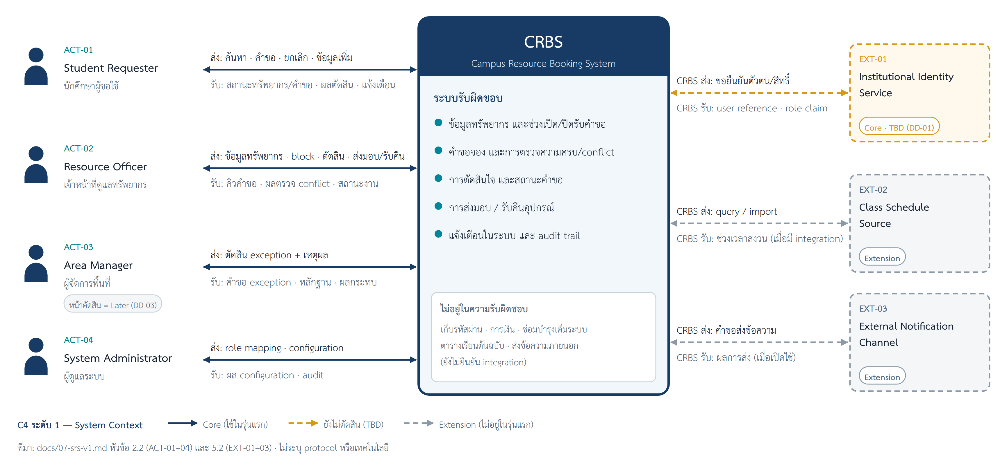
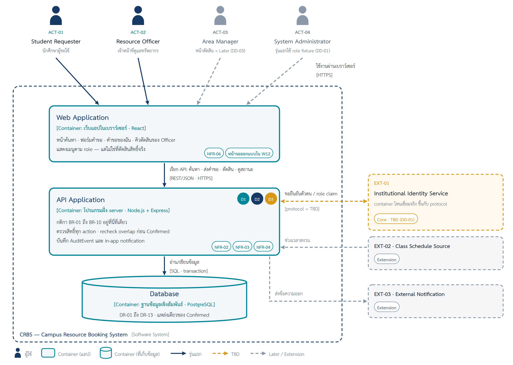

# Conceptual Architecture — CRBS (ไม่บังคับ)

> ไฟล์นี้เป็นทางเลือก ใช้สรุปสั้นให้อ่านบน GitHub ได้ · เอกสารหลักคือ `design/11-conceptual-architecture-v0.1.docx`
> ถ้าข้อความในไฟล์นี้ไม่ตรงกับไฟล์ Word ให้ถือไฟล์ Word เป็นหลัก

| รายการ | ค่า |
|---|---|
| ฐาน SRS | `docs/07-srs-v1.md` (`CRBS-SRS-W07-v1.1`) สถานะ Baseline Candidate — not approved baseline; OI-01–OI-08 ยังเปิด |
| เอกสารหลัก | [11-conceptual-architecture-v0.1.docx](11-conceptual-architecture-v0.1.docx) — Design Draft · 11 หัวข้อ · ภาพที่ 1–5 |
| ข้อมูลเข้า | [Design Strategy v0.1](10-design-strategy.md) + [Design Spine](00-design-spine.md) (W10) |
| Stack อ้างอิง | React · Node.js + Express · PostgreSQL — Proposed (ให้ Dev ยืนยัน: DD-06) |
| Change request ที่รู้ | `CR-01-SIM` — Pending (ไม่นำมาใช้ในแบบนี้) |

## ภาพ

*ภาพที่ 2 — C4 ระดับ 1: CRBS 1 กล่อง · ACT-01–04 · EXT-01 Institutional Identity Service (Core · TBD, DD-01) · EXT-02 Class Schedule Source และ EXT-03 External Notification Channel (Extension) · ต้นฉบับ [`11-context.drawio`](../diagrams/architecture/11-context.drawio)*

*ภาพที่ 3 — C4 ระดับ 2: Web Application · API Application · Database · ต้นฉบับ [`11-container.drawio`](../diagrams/architecture/11-container.drawio)*

ภาพประกอบอื่นในไฟล์ Word (.drawio + .png อยู่ใน `diagrams/architecture/`): ภาพที่ 1 `11-bridge-w10-to-w11` · ภาพที่ 4 `11-where-containers-run` · ภาพที่ 5 `11-d2-where-the-rule-lives`

## Container (สรุปจากหัวข้อ 3–4)

| Container | [ชนิด · เทคโนโลยี] | หน้าที่ | รันที่ไหน / ใครควบคุม |
|---|---|---|---|
| Web Application | เว็บแอปในเบราว์เซอร์ · React | หน้าจอของ Requester และ Officer: ค้นหา · ฟอร์มคำขอ · คำขอของฉัน · คิวตัดสิน; แสดงเมนูตาม role — ไม่เก็บข้อมูลถาวร | เบราว์เซอร์บนเครื่องผู้ใช้ — ผู้ใช้ควบคุม |
| API Application | โปรแกรมฝั่ง server · Node.js + Express | กติกา BR-01–BR-10 · ตรวจสิทธิ์ทุก action · precheck/recheck overlap · เปลี่ยน state · บันทึก AuditEvent และ in-app notification — ไม่เก็บข้อมูลเอง อ่าน/เขียนผ่าน Database | server ของทีม — ทีมควบคุม |
| Database | ฐานข้อมูลเชิงสัมพันธ์ · PostgreSQL | เก็บข้อมูลทั้งหมดของระบบ (DR-01–DR-13) · แหล่งเดียวของ Confirmed | server ฐานข้อมูล — ทีมควบคุม · เข้าถึงผ่าน API เท่านั้น |

เส้นที่คุยกัน: Web Application → API Application [REST/JSON · HTTPS] · API Application → Database [SQL · transaction] · API Application ↔ EXT-01 [protocol = TBD] · EXT-02/03 = Extension

ไม่ใช้ในรุ่นแรก (หัวข้อ 4): แอปมือถือ · แอป desktop · งานตามเวลา (scheduled job) — SRS ไม่มี requirement ที่ต้องใช้ และ no-show บันทึกโดย Officer (FR-14)

> **ต่อจาก W10:** drivers ใน W10 อ้างถึง "กล่อง" Validation & Conflict · Notification & Audit · Access/Role — ที่ระดับ container (C4 ระดับ 2) หน้าที่เหล่านี้อยู่ใน API Application ทั้งหมด (DEC-01) ไม่ได้เป็น container แยก · W13 จะซูมเข้า API Application เป็น component diagram (C4 ระดับ 3) ตามหัวข้อ 9 ของไฟล์ Word

## NFR → container (หัวข้อ 5)

| NFR | ต้องการอะไร (docs/07 หัวข้อ 4) | ผลต่อ container | สถานะ |
|---|---|---|---|
| NFR-01 | ไม่เก็บ password หรือเลขบัตรประชาชน | ไม่มี container ไหนเก็บรหัสผ่าน · ยืนยันตัวตนผ่าน EXT-01 | protocol TBD (DD-01, OI-03) |
| NFR-02 | อ่านและทำได้ตาม role · unit scope · ownership | API Application ตรวจทุก action · Web Application แค่ซ่อนเมนู | DEC-01 |
| NFR-03 | audit ทุก state change และ decision | API Application เขียน AuditEvent ลง Database พร้อมการเปลี่ยน state | DEC-01, DEC-02 |
| NFR-04 | Approve พร้อมกันต้องไม่เกิด Confirmed ซ้อน | recheck ที่ API Application + Database เดียวที่รองรับ transaction | DEC-02 · กลไกจริง = DD-02 |
| NFR-05 | ค้นหาเร็วพอภายใต้ workload ที่ตกลง | ยังไม่เพิ่ม cache หรือ search engine | TBD — OI-01 (DD-04) |
| NFR-06 | flow หลักของ Core ทำจนจบได้ด้วย keyboard · ทุก input มี label · สถานะเป็นข้อความ · error ระบุ field/เงื่อนไขและสิ่งที่ต้องทำต่อ | Web Application — ออกแบบหน้าจอใน W12 | ส่งต่อ W12 |
| NFR-07 | ป้องกันข้อมูลสูญหายตาม recovery objective | backup/restore เป็นเรื่อง deployment — ไม่ออกแบบใน W11 | TBD — OI-02 (DD-05) |
| NFR-08 | log มี correlation reference ไม่เปิด PII เกินจำเป็น | API Application เขียน operational log ตามกติกานี้ | retention TBD — OI-02 |

## Decision cards (สถานะ Proposed)

| ID | ตัดสินใจ | เพราะ (NFR / driver) |
|---|---|---|
| DEC-01 | กติกาและการตรวจสิทธิ์อยู่ที่ API Application ไม่ใช่ที่หน้าเว็บ — API เป็นที่เดียวที่ตรวจ BR-01–BR-10 และสิทธิ์ของทุก action | NFR-02 · NFR-03 · NFR-04 · D2 · D3 |
| DEC-02 | ฐานข้อมูลเดียวที่รองรับ transaction เป็นแหล่งของ Confirmed — recheck กับการบันทึก Confirmed อยู่ใน transaction เดียวกัน | NFR-04 · NFR-03 · DR-07/09/10 ผูกกันแน่น · D2 |
| DEC-03 | เว็บแอปเดียว แสดงหน้าตาม role (Requester และ Officer ใช้ Web Application เดียวกัน) | ทุก actor ใช้ผ่านหน้าจอทั่วไป — Requester ใน UC-01–UC-03 และ Officer ใน UC-04 · NFR-06 · SRS ไม่มี requirement ที่ต้องใช้ความสามารถเฉพาะของมือถือ |
| DEC-04 | ใช้ stack อ้างอิงของรายวิชา: React · Node.js + Express (REST API ส่ง JSON ผ่าน HTTPS) · PostgreSQL | ตรงกับชนิดที่ DEC-01–03 ต้องการ · PostgreSQL รองรับ transaction (NFR-04) · หน้าเว็บกับ API ใช้ JavaScript ภาษาเดียว |

## Open decisions ที่เปิดอยู่

| ID | เรื่อง | ระหว่างรอทำอย่างไร | เจ้าของคำตอบ |
|---|---|---|---|
| DD-01 | identity service และ protocol/field ที่ส่งมา (OI-03) — กระทบ API Application + EXT-01 | role fixture: ผู้ใช้ทดสอบพร้อม role ที่กำหนดล่วงหน้า · ไม่เก็บรหัสผ่าน | Security/Interface reviewer (ผู้สอนในกรณีสอน) |
| DD-02 | กลไกกันสอง Approve พร้อมกัน — กระทบ API Application + Database | recheck ก่อน Confirmed ทุกครั้ง · Dev เลือกกลไกและเขียน race scenario ไว้ทดสอบ | Dev |
| DD-03 | precheck พบ block ในรุ่นแรก — กระทบ API Application + Web Application | Officer เห็น "รอ Area Manager" อ่านอย่างเดียว | ผู้สอน / Product owner ของกรณีสอน |
| DD-04 | เป้าหมาย performance ของการค้นหา (OI-01) — กระทบ API Application + Database | ไม่กำหนดตัวเลข · ยังไม่เพิ่ม cache | Product Owner / Instructor |
| DD-05 | retention / backup / recovery (OI-02) — กระทบ Database | ไม่ลบ audit/decision ในรุ่นแรก · backup เป็นงาน deployment | Data/Operations reviewer |
| DD-06 (ใหม่) | ยืนยัน stack และ version — กระทบทุก container | ใช้ stack อ้างอิงตาม DEC-04 ระหว่างรอ | Dev |

> ไฟล์ Word ทำจาก Template W11 ของรายวิชา ใส่เฉพาะผลลัพธ์ · ร่างหัวข้อ 5 และ 8 ของชลิตาอยู่ในประวัติไฟล์นี้ (commit 29 ก.ย.) · DEC-03 อ้าง UC-04 ตาม sticky ของคู่ review
