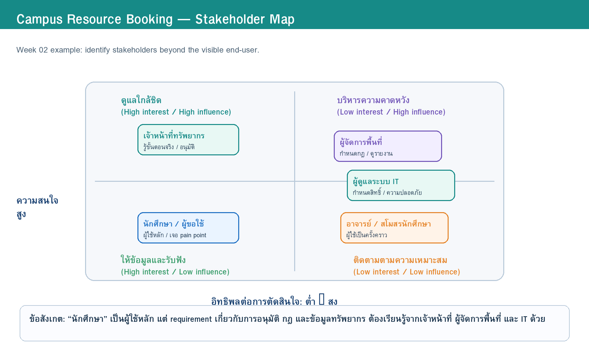
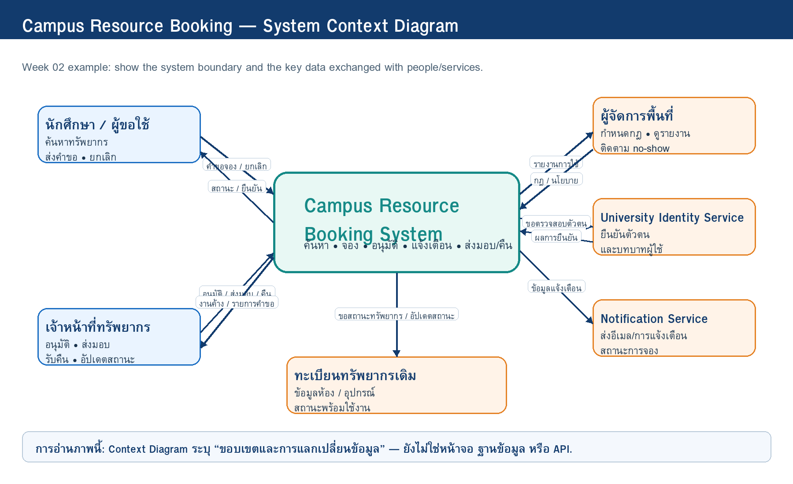

# 02 — Stakeholder, System Context and Scope

> **ที่มา (repo ตัวอย่าง):** เนื้อหาส่วนใหญ่ดัดแปลงจากตัวอย่าง CRBS ของผู้สอนใน Course Repo `campus_resource_booking_case/week02-campus-resource-booking-example/docs/02-stakeholder-context-scope.md` — กลุ่มจริงต้องเขียนจาก case และหลักฐานของกลุ่มเอง

> **Week 2 deliverable**  
> เวอร์ชัน: v0.1 | สถานะ: Draft | วันที่ปรับปรุง: 12/07/2026  
> Diagram source of truth: ไฟล์ `.drawio` ใน `diagrams/stakeholders/` และ `diagrams/context/` (ไฟล์ `.png` เป็นภาพ export)

## 0. Problem Frame (ปรับจาก Problem Brief v0.1)

### 0.1 สถานการณ์ปัจจุบัน

นักศึกษาที่ต้องการใช้ห้องทำงานกลุ่มหรือยืมอุปกรณ์ เช่น โปรเจกเตอร์ สาย HDMI และจอเสริม ต้องสอบถามสถานะผ่านหลายช่องทาง เช่น ป้ายหน้าห้อง กลุ่ม LINE หรือเจ้าหน้าที่ ทำให้ข้อมูลว่างไม่เป็นปัจจุบัน มีการจองซ้ำ และไม่ทราบว่าใครต้องอนุมัติหรือเงื่อนไขใดใช้กับทรัพยากรแต่ละประเภท

### 0.2 ใครได้รับผลกระทบ

- **นักศึกษา / ผู้ขอใช้:** เสียเวลาสอบถามหลายช่องทาง และอาจเดินทางไปแล้วพบว่าห้องหรืออุปกรณ์ไม่ว่าง (PP-01, PP-02)
- **เจ้าหน้าที่ทรัพยากร:** ต้องตอบคำถามเดิมซ้ำ ตรวจสอบตารางจากหลายไฟล์ และติดตามการส่งคืนด้วยมือ (F-03, PP-03)
- **ผู้จัดการพื้นที่:** มองไม่เห็นภาพรวมการใช้งาน อัตราการไม่มาตามนัด และปัญหาการใช้ทรัพยากร
- **ผู้ดูแลระบบ IT:** ต้องคุมสิทธิ์ผู้ใช้ ความปลอดภัย และการเชื่อมบัญชีสถาบัน

### 0.3 Problem Statement

> กระบวนการจองพื้นที่ทำงานกลุ่มและอุปกรณ์การเรียนรู้ยังไม่มีข้อมูลสถานะที่รวมศูนย์และตรวจสอบได้ ทำให้เกิดการจองชนกัน การสื่อสารล่าช้า ภาระงานเจ้าหน้าที่สูง และผู้ใช้ไม่ทราบกฎหรือสถานะคำขออย่างชัดเจน

### 0.4 ผลลัพธ์ที่ต้องการ (โดยยังไม่กำหนด solution)

1. ผู้ใช้เห็นข้อมูลทรัพยากรและเวลาว่างที่น่าเชื่อถือ
2. เจ้าหน้าที่จัดการคำขอและติดตามสถานะได้เป็นระบบ
3. ผู้จัดการพื้นที่มองเห็นข้อมูลการใช้ทรัพยากรและปัญหาเชิงภาพรวม
4. กฎการจอง การอนุมัติ และการยกเลิกมีความโปร่งใส

### 0.5 สิ่งที่ทีมยังต้องเรียนรู้

- การจองประเภทใดต้องผ่านการอนุมัติ และใครมีสิทธิ์อนุมัติ
- กำหนดเวลาจองล่วงหน้า ระยะเวลาใช้งาน และกติกายกเลิกคืออะไร
- การส่งมอบและคืนอุปกรณ์ต้องมีหลักฐานหรือการตรวจสอบระดับใด
- ช่องทางแจ้งเตือนที่เหมาะสมและข้อมูลที่ควรแจ้งมีอะไรบ้าง

(ทั้งหมดเขียนเป็น Open Questions ใน §7)

## 1. Stakeholder Map

> **Source:** [`w02-stakeholder-map.drawio`](../diagrams/stakeholders/w02-stakeholder-map.drawio) — ตำแหน่งบนแผนภาพตรงกับคอลัมน์ Influence/Interest ในตาราง

| Stakeholder / External System | Category | Role / งานปัจจุบัน | Needs / Goals | Influence | Interest | Engagement Approach | Why it matters |
|---|---|---|---|---|---|---|---|
| นักศึกษา / ผู้ขอใช้ | Primary user | ค้นหาห้องหรืออุปกรณ์ ส่งคำขอ และยกเลิก | รู้สถานะจริง จองง่าย และได้รับแจ้งเตือนทันเวลา | กลาง | สูง | ให้ข้อมูลและรับฟัง — interview + ทดลองคำถามกับ peer | เป็นผู้ใช้หลักและพบ pain point โดยตรง |
| เจ้าหน้าที่ทรัพยากร | Primary user (operator) | ตรวจคำขอ อนุมัติ ส่งมอบ รับคืน และแก้ปัญหาเฉพาะหน้า | ลดงานซ้ำ ตรวจสอบกฎง่าย และเห็นรายการค้าง | สูง | สูง | ดูแลใกล้ชิด — interview + วิเคราะห์กฎ/เอกสาร + สังเกต workflow จำลอง | รู้ workflow จริง กฎ และกรณียกเว้น |
| ผู้จัดการพื้นที่ / เจ้าของกระบวนการ | Secondary (decision owner) | กำหนดนโยบาย ติดตามการใช้พื้นที่ และตัดสินใจ | เห็นรายงานและควบคุมกติกาให้เป็นธรรม | สูง | กลาง | บริหารความคาดหวัง — interview + เอกสารนโยบาย + role-play case | มีอำนาจกำหนดกฎและขอบเขตการเปลี่ยนแปลง |
| ผู้ดูแลระบบ IT | Secondary (constraint owner) | ดูแลสิทธิ์ บัญชีผู้ใช้ ความปลอดภัย และบริการสนับสนุน | ใช้บัญชีสถาบัน ลดความเสี่ยงด้านข้อมูล | สูง | กลาง | บริหารความคาดหวัง — interview ด้วยคำถามข้อจำกัด identity/สิทธิ์ | กำหนดข้อจำกัดเชิงเทคนิคและการเข้าถึงข้อมูล |
| อาจารย์ / สโมสรนักศึกษา | Secondary user | ใช้ห้องหรืออุปกรณ์เป็นครั้งคราว | จองสำหรับกิจกรรม/การสอนและทราบสถานะ | ต่ำ | กลาง | ติดตามตามความเหมาะสม — ใช้เหตุการณ์จำลอง "อาจารย์ขอสงวนห้องเร่งด่วน" ใน Case Card | เป็นผู้ใช้รองที่อาจมีเงื่อนไขต่างจากนักศึกษา |
| University Identity Service | External system | ยืนยันตัวตนและบทบาทผู้ใช้ | ให้ข้อมูลตัวตนเท่าที่จำเป็น | สูง | ต่ำ | ตรวจข้อจำกัดผ่านผู้ดูแลระบบ IT | เป็นระบบภายนอกที่กำหนดการ login และสิทธิ์ |
| Notification Service | External system | ส่งอีเมลหรือการแจ้งเตือน | ส่งข้อมูลที่ถูกต้องและตรงเวลา | กลาง | ต่ำ | ตรวจข้อจำกัดผ่านผู้ดูแลระบบ IT | รองรับการสื่อสารสถานะกับผู้ใช้ |
| ทะเบียนทรัพยากรเดิม | External data source | เก็บข้อมูลห้อง/อุปกรณ์และสถานะเบื้องต้น | ข้อมูลทรัพยากรสอดคล้องกัน | กลาง | กลาง | document analysis ร่วมกับเจ้าหน้าที่ | เป็นแหล่งข้อมูลที่ต้องตรวจสอบความพร้อมใช้งาน |

### 1.1 Stakeholder Profiles

#### นักศึกษา / ผู้ขอใช้

- **Goal / need:** ค้นหาห้องหรืออุปกรณ์ที่ว่าง จองได้รวดเร็ว และทราบผลการจองโดยไม่ต้องติดตามหลายช่องทาง
- **Pain point:** ข้อมูลว่างไม่ตรงกัน จองชนกัน และไม่แน่ใจว่าต้องรออนุมัติหรือไม่
- **Concern / risk:** กลัวพลาดเวลาส่งงานหรือกิจกรรมเพราะไม่ได้รับสถานะที่ชัดเจน
- **Information this stakeholder knows:** ช่วงเวลาที่ต้องใช้จริง รูปแบบการค้นหาปัจจุบัน และปัญหาที่เกิดจากการจองซ้ำ
- **Influence / decision power:** กลาง — ใช้งานมาก แต่ไม่ได้กำหนดกฎการจอง
- **Open questions for Week 3:** ผู้ใช้ต้องการเห็นข้อมูลใดก่อนตัดสินใจจอง? การแจ้งเตือนแบบใดช่วยลดการพลาดสถานะ?

#### เจ้าหน้าที่ทรัพยากร

- **Goal / need:** ตรวจคำขอ อนุมัติ และติดตามการคืนทรัพยากรได้โดยไม่ต้องเปิดหลายไฟล์หรือแชตหลายกลุ่ม
- **Pain point:** ได้รับคำถามซ้ำ ข้อมูลกระจัดกระจาย และต้องจำกฎ/ข้อยกเว้นด้วยตนเอง
- **Concern / risk:** การอนุมัติผิดทรัพยากร การลืมติดตามคืน หรือผู้ใช้ไม่ทราบเงื่อนไข
- **Information this stakeholder knows:** ขั้นตอนปัจจุบัน กฎจริง กรณียกเว้น และเหตุผลที่คำขอบางรายการถูกปฏิเสธ
- **Influence / decision power:** สูง — เป็นผู้ดำเนินงานและอาจอนุมัติคำขอ
- **Open questions for Week 3:** ทรัพยากรชนิดใดต้องอนุมัติ? เกณฑ์ใดใช้ตัดสินใจ? ต้องบันทึกการส่งมอบ/คืนระดับใด?

#### ผู้จัดการพื้นที่ / เจ้าของกระบวนการ

- **Goal / need:** ให้ทรัพยากรถูกใช้อย่างคุ้มค่า เป็นธรรม และตรวจสอบได้
- **Pain point:** ไม่มีรายงานภาพรวมเรื่องการใช้ห้อง การยกเลิก หรือ no-show
- **Concern / risk:** การกำหนดกฎที่ไม่สอดคล้องกับการใช้งานจริง และการใช้ทรัพยากรโดยไม่เป็นธรรม
- **Information this stakeholder knows:** นโยบาย กฎการจอง ข้อจำกัดด้านเวลา และตัวชี้วัดที่ต้องการติดตาม
- **Influence / decision power:** สูง — กำหนดกฎและอนุมัติแนวทางการทำงาน
- **Open questions for Week 3:** ต้องการรายงานแบบใด? กฎการจองล่วงหน้าและ no-show เป็นอย่างไร? มีทรัพยากรใดต้องสงวนสิทธิ์?

#### ผู้ดูแลระบบ IT

- **Goal / need:** ระบบใช้บัญชีสถาบัน มีสิทธิ์ตามบทบาท และไม่เก็บข้อมูลเกินจำเป็น
- **Pain point:** ระบบใหม่อาจขอข้อมูลมากเกินไป หรือทำให้เกิดภาระดูแลหลายบัญชี
- **Concern / risk:** ข้อมูลส่วนบุคคลรั่วไหล สิทธิ์ไม่เหมาะสม หรือการเชื่อมระบบภายนอกทำไม่ได้
- **Information this stakeholder knows:** ข้อจำกัดด้าน identity, access control, integration และ security baseline
- **Influence / decision power:** สูง — อนุญาตหรือจำกัดแนวทางเชิงเทคนิค
- **Open questions for Week 3:** ใช้ข้อมูลบัญชีใดได้บ้าง? ระบบควรเก็บข้อมูลใดเอง? ผู้ใช้แต่ละบทบาทเห็นข้อมูลอะไรได้?

## 2. System Context

ขอบเขตระบบ ความสัมพันธ์กับผู้ใช้/ระบบภายนอก และข้อมูลที่เข้าออก

> **Source:** [`w02-system-context.drawio`](../diagrams/context/w02-system-context.drawio)

### 2.1 System Boundary

ขอบเขตของ **Campus Resource Booking System** ครอบคลุมการค้นหาทรัพยากร การส่งคำขอจอง การตรวจสอบ/อนุมัติ การแจ้งสถานะ และการบันทึกการส่งมอบ–คืนในระดับที่กำหนด ระบบ **ไม่ใช่** ระบบจัดซื้อ ซ่อมบำรุง หรือระบบควบคุมประตูอาคาร

### 2.2 Key Data Flows

| From → To | Data / Request | Why it matters |
|---|---|---|
| นักศึกษา → ระบบ | คำขอจอง ยกเลิก/แก้ไขคำขอ | เป็นจุดเริ่ม workflow ของผู้ใช้หลัก |
| ระบบ → นักศึกษา | สถานะ ยืนยัน กฎ/เงื่อนไข และการแจ้งเตือน | ลดความไม่แน่นอนและการถามซ้ำ |
| เจ้าหน้าที่ → ระบบ | อนุมัติ ปฏิเสธ ส่งมอบ รับคืน และอัปเดตสถานะ | แสดงงานปฏิบัติจริงที่ต้องรองรับ |
| ระบบ → เจ้าหน้าที่ | รายการคำขอ งานค้าง และข้อมูลทรัพยากร | ช่วยลดงานจากหลายไฟล์/หลายแชต |
| ผู้จัดการพื้นที่ ↔ ระบบ | กฎ/นโยบาย และรายงานภาพรวม | ทำให้ requirement เชื่อมกับเป้าหมายระดับหน่วยงาน |
| ระบบ ↔ Identity Service | คำขอตรวจสอบบัญชีและบทบาท | ลดการสร้างบัญชีใหม่ และรองรับ access control |
| ระบบ → Notification Service | ข้อมูลแจ้งเตือนสถานะ | ทำให้ผู้ใช้ทราบสถานะตามเวลาที่เหมาะสม |
| ระบบ ↔ ทะเบียนทรัพยากรเดิม | ข้อมูลทรัพยากรและสถานะ | ลดความคลาดเคลื่อนระหว่างข้อมูลทรัพยากรกับการจอง |

## 3. Scope Statement

### In Scope

| Area | Included capability | Rationale |
|---|---|---|
| Search | ผู้ใช้ที่ยืนยันตัวตนด้วยบัญชีสถาบันสามารถค้นหาห้องและอุปกรณ์ตามประเภท วันที่ และช่วงเวลาได้ | PP-01 · ผลลัพธ์ §0.4 ข้อ 1 |
| Booking request | ผู้ใช้สามารถส่งคำขอจอง ดูสถานะ และยกเลิกคำขอตามกติกาที่กำหนดได้ | PP-02 · ผลลัพธ์ §0.4 ข้อ 4 |
| Review and handover | เจ้าหน้าที่สามารถตรวจสอบ อนุมัติ/ปฏิเสธ และบันทึกการส่งมอบ/คืนในระดับพื้นฐานได้ | PP-03, F-04 · ผลลัพธ์ §0.4 ข้อ 2 |
| Notification | ระบบแจ้งสถานะการจองที่สำคัญแก่ผู้ใช้ผ่านช่องทางที่หน่วยงานกำหนด | ลดการถามซ้ำ (data flow ระบบ → นักศึกษา) · OQ-05 |
| Basic reporting | ผู้จัดการพื้นที่ดูรายงานเบื้องต้น เช่น จำนวนการจอง การยกเลิก และ no-show ได้ | ผลลัพธ์ §0.4 ข้อ 3 |

### Out of Scope

| Area | Excluded capability | Reason |
|---|---|---|
| Payment | ระบบรับชำระเงินหรือค่าปรับออนไลน์ | Case Card: ไม่รวมระบบชำระเงิน |
| Access hardware | ระบบควบคุมประตูหรือการเข้าถึงพื้นที่ด้วย hardware จริง | Case Card: Out of Scope |
| Procurement and maintenance | ระบบจัดซื้อ ซ่อมบำรุง หรือจัดการคลังพัสดุเต็มรูปแบบ | Case Card + feedback tabletop (§8) — คงไว้เฉพาะการบันทึกสภาพ/คืนระดับพื้นฐาน |
| AI forecasting | การพยากรณ์การใช้งานด้วย AI หรือระบบแนะนำทรัพยากรขั้นสูง | เกินโจทย์การจองและเวลา 1 ภาคการศึกษา (CT-04) |
| Calendar integration | การเชื่อมต่อปฏิทินภายนอกทุกแพลตฟอร์มในระยะเริ่มต้น | ลดขนาดงานระยะเริ่มต้น (CT-04) |

## 4. Constraints and Business Rules

| ID | Constraint / Rule | Source | Impact |
|---|---|---|---|
| CT-01 | เริ่มจาก 1 อาคาร/1 หน่วยงาน | Case Card | จำกัดชุดทรัพยากรและผู้ดูแลที่ต้องรองรับ |
| CT-02 | ใช้ข้อมูลผู้ใช้จำลอง ไม่เก็บข้อมูลบัตรประชาชน และไม่ใช้ข้อมูลส่วนบุคคลจริงหรือเชื่อมต่อระบบมหาวิทยาลัยจริงในระยะเรียน | Case Card + การวิเคราะห์ทีม | ทุก flow ใช้ข้อมูลจำลอง และจำกัดข้อมูลที่ระบบเก็บ (§5) |
| CT-03 | ต้องพิจารณาการยกเลิก การคืนล่าช้า และทรัพยากรชำรุด | Case Card | ต้องมี flow ยกเลิก/คืนล่าช้า/บันทึกสภาพ (OQ-03, OQ-04) |
| CT-04 | เป็นโครงงานเพื่อการเรียนรู้ภายใน 1 ภาคการศึกษา ทีมมีสมาชิก 4 คน และเวลาออกแบบจำกัด | บริบทรายวิชา | ต้องคุม scope ตาม §3 |
| CT-05 | ข้อมูลทะเบียนทรัพยากรเดิมอาจไม่ครบหรือมีรูปแบบไม่มาตรฐาน | การวิเคราะห์ทีม | ต้องตรวจความพร้อมของข้อมูลทรัพยากรก่อนใช้ |

> **Business Rules:** ยังไม่มีกฎที่ยืนยันได้ — กฎอนุมัติ การจองล่วงหน้า และ no-show ยังเป็น Open Question (§7) จนกว่าจะมีหลักฐาน

### Assumptions

- A-01 (จาก W01): การอนุมัติการจองพิเศษทำโดยเจ้าหน้าที่ — ยังต้องตรวจสอบ (OQ-01)
- A-02: ห้องและอุปกรณ์มีรหัสที่ระบุได้ และมีผู้รับผิดชอบสถานะเบื้องต้น
- A-03: ผู้ใช้สามารถยืนยันตัวตนด้วยบัญชีสถาบันได้
- A-04: มีเจ้าหน้าที่หรือผู้แทนที่สามารถทำหน้าที่อนุมัติหรือส่งมอบได้
- A-05: หน่วยงานยอมรับการใช้การแจ้งเตือนทางอีเมลหรือช่องทางจำลองในโครงงาน

## 5. Ethics, Privacy and Accessibility Considerations

- ข้อมูลส่วนบุคคลที่ระบบอาจเกี่ยวข้อง: รหัสผู้ใช้ บทบาท ข้อมูลคำขอ และหลักฐานการรับ–คืน — เก็บเท่าที่จำเป็นต่อการจอง (CT-02)
- ความเสี่ยงด้านสิทธิ์การเข้าถึง/ความปลอดภัย: นักศึกษาต้องไม่เห็นคำขอของผู้อื่น และเจ้าหน้าที่/ผู้จัดการเห็นเฉพาะข้อมูลตามหน้าที่
- การเข้าถึงสำหรับผู้ใช้หลากหลายกลุ่ม: ยังไม่มีหลักฐาน — ใช้ UN-06 (อ่านได้ทั้ง desktop/mobile) เป็นจุดเริ่ม และผู้ใช้รอง (อาจารย์/สโมสร) อาจมีเงื่อนไขต่างจากนักศึกษา ต้องตรวจใน W03–W04
- ข้อควรระวังด้านจริยธรรม: กฎการจองและ no-show ต้องบังคับใช้สม่ำเสมอ และ AI ห้ามสร้าง "ข้อเท็จจริงจาก stakeholder" แทนหลักฐาน

| ประเด็น | การตัดสินใจ/ข้อควรระวังใน Case นี้ |
|---|---|
| Data minimization | เก็บเฉพาะรหัสผู้ใช้ บทบาท ข้อมูลคำขอ และหลักฐานที่จำเป็นต่อการจอง ไม่เก็บข้อมูลส่วนบุคคลที่ไม่เกี่ยวข้อง |
| Role-based access | นักศึกษาเห็นเฉพาะคำขอของตน เจ้าหน้าที่เห็นคำขอที่รับผิดชอบ ผู้จัดการเห็นรายงานรวม |
| Transparency | ผู้ใช้ควรเห็นว่าใคร/กฎใดทำให้คำขอเปลี่ยนสถานะ และควรเห็นเหตุผลเมื่อถูกปฏิเสธ |
| Fairness | กฎการจองและ no-show ต้องบังคับใช้สม่ำเสมอ และมีข้อยกเว้นที่อธิบายได้ |
| Responsible AI | AI อาจช่วยตรวจถ้อยคำหรือสรุปโครงเอกสารได้ แต่ห้ามสร้าง "ข้อเท็จจริงจาก stakeholder" แทนหลักฐาน และทุกข้อความต้องตรวจทานกับ Case/role card |

## 6. Baseline Scope Decision

ทีมตกลงใช้ In Scope / Out of Scope ใน §3 และ constraints CT-01–CT-05 ใน §4 เป็น scope baseline หลัง Week 2 (บันทึกเป็น **D-01** ใน [`project-management/decision-log.md`](../project-management/decision-log.md)):

1. ระบบจัดซื้อ ซ่อมบำรุง และคลังพัสดุอยู่นอก scope — คงไว้เฉพาะการบันทึกสภาพ/คืนอุปกรณ์ในระดับพื้นฐาน
2. แยกบทบาทเจ้าหน้าที่ทรัพยากร ผู้จัดการพื้นที่ และผู้ดูแลระบบ IT ออกจากกัน เพราะมีข้อมูลและอำนาจตัดสินใจต่างกัน
3. กฎที่ยังไม่มีหลักฐาน (อนุมัติ จองล่วงหน้า no-show หลักฐานรับ–คืน การแจ้งเตือน) ยังไม่เขียนเป็น business rule แต่ส่งต่อเป็น Open Questions ให้ Week 03

## 7. Open Questions ส่งต่อ Week 03

| ID | Open Question | Why it matters | Priority | ส่งต่อ Week 03 อย่างไร |
|---|---|---|---|---|
| OQ-01 | การจองประเภทใดต้องผ่านการอนุมัติ และใครเป็นผู้อนุมัติ? | กำหนด workflow และ role ของระบบ | High | สัมภาษณ์เจ้าหน้าที่ + วิเคราะห์กฎ/เอกสาร |
| OQ-02 | ผู้ใช้จองล่วงหน้าได้กี่วัน และจองได้นานเท่าใด? | กำหนด validation rule | High | สัมภาษณ์ผู้จัดการพื้นที่ + เอกสารนโยบาย |
| OQ-03 | หากผู้ใช้ยกเลิก late หรือไม่มาตามนัด ต้องจัดการอย่างไร? | กระทบความเป็นธรรมและรายงาน | High | สัมภาษณ์เจ้าหน้าที่/ผู้จัดการ + role-play case |
| OQ-04 | การรับ–คืนอุปกรณ์ต้องเก็บหลักฐานอะไร และใครยืนยัน? | กำหนดข้อมูล/ความรับผิดชอบ | Medium | สังเกต workflow จำลอง + สัมภาษณ์เจ้าหน้าที่ |
| OQ-05 | ช่องทางและจังหวะการแจ้งเตือนใดเหมาะสม? | กระทบ usability และลดการพลาดสถานะ | Medium | สัมภาษณ์นักศึกษา + ทดลองคำถามกับ peer |
| OQ-06 | เจ้าหน้าที่ต้องเห็นข้อมูลใดในหน้าจอเดียว / ใช้รายงานใดทุกวัน? (ยกมาจาก Problem Brief และ Case Card) | ออกแบบหน้าจอหลักของเจ้าหน้าที่ | Medium | ฟังจากคำถาม workflow ของเจ้าหน้าที่ใน Week 03 |

## 8. Tabletop Studio Feedback Action

### Feedback received

- **ทีมคู่ตรวจสมมติ (Group 00B, Group 00C — fictional partner groups ของ repo ตัวอย่าง ไม่มี repo จริง):** แนะนำให้แยก "เจ้าหน้าที่ทรัพยากร" ออกจาก "ผู้จัดการพื้นที่" เพราะทั้งสองบทบาทมีข้อมูลและอำนาจตัดสินใจต่างกัน
- **Group 00B:** ถามว่าการอนุมัติอาจต่างกันตามประเภททรัพยากรหรือไม่ จึงควรระบุเป็น open question
- **Group 00C:** ถามว่าการซ่อมอุปกรณ์อยู่ใน scope หรือไม่
- **Instructor cue (จำลองสำหรับ repo ตัวอย่าง — ไม่ใช่ข้อความจริงของผู้สอน):** ระบบยังไม่ควรครอบคลุมการซ่อมบำรุงและจัดซื้อ เพราะจะขยาย scope เกินโจทย์การจอง

รายละเอียดอยู่ใน [`feedback/week-02-peer-feedback.md`](../feedback/week-02-peer-feedback.md)

### What the team changed

1. เพิ่ม stakeholder profile ของผู้จัดการพื้นที่และ IT administrator (§1.1)
2. แยก OQ-01 เรื่องกฎอนุมัติออกจาก OQ-04 เรื่องหลักฐานรับ–คืน (§7)
3. ย้ายการซ่อมบำรุงและจัดซื้อไป Out of Scope (§3, D-01)

### What remains uncertain for Week 3

- เงื่อนไขอนุมัติรายทรัพยากร
- กฎจองล่วงหน้า / ยกเลิก / no-show
- หลักฐานการรับ–คืนอุปกรณ์
- ช่องทางแจ้งเตือนและเวลาแจ้งที่เหมาะสม
