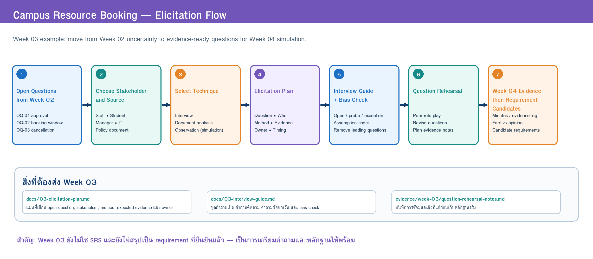

# 03 — Elicitation Plan

> Week 03 | Team: Group 00 | Case: Case X — CRBS (Campus Resource Booking)  
> เวอร์ชัน: v0.1 | สถานะ: Draft | วันที่ปรับปรุง: 14/07/2026

## 1. Inputs from Week 02

- Problem Brief: [`01-problem-brief-v0.1.md`](01-problem-brief-v0.1.md)
- Stakeholder/Context/Scope: [`02-stakeholder-context-scope.md`](02-stakeholder-context-scope.md)

| OQ ID | Open Question | Impact if unresolved | Candidate source |
|---|---|---|---|
| OQ-01 | การจองประเภทใดต้องอนุมัติ และใครเป็นผู้อนุมัติ? | กำหนด workflow, role และสิทธิ์ในระบบไม่ได้ | เจ้าหน้าที่ทรัพยากร + ผู้จัดการพื้นที่ |
| OQ-02 | ผู้ใช้จองล่วงหน้าได้กี่วัน และจองได้นานเท่าใด? | กำหนด validation rule และความเป็นธรรมในการใช้ทรัพยากรไม่ได้ | ผู้จัดการพื้นที่ + เอกสารนโยบายจำลอง |
| OQ-03 | การยกเลิก late หรือ no-show ต้องจัดการอย่างไร? | กระทบการใช้ทรัพยากร การแจ้งเตือน และรายงาน | เจ้าหน้าที่ทรัพยากร + ผู้จัดการพื้นที่ |
| OQ-04 | การรับ–คืนอุปกรณ์ต้องเก็บหลักฐานอะไร? | ไม่รู้ข้อมูลที่ต้องบันทึกและผู้รับผิดชอบ | เจ้าหน้าที่ทรัพยากร |
| OQ-05 | ช่องทางแจ้งเตือนใดเหมาะสม และควรแจ้งเวลาใด? | กระทบ usability และการพลาดสถานะ | นักศึกษา / ผู้ขอใช้ |
| A-03 (assumption) | ผู้ใช้ทุกคนสามารถใช้บัญชีสถาบันเดียวกันเพื่อเข้าสู่ระบบได้ | กระทบ authentication และ role-based access | ผู้ดูแลระบบ IT |

> OQ-06 (ข้อมูลที่เจ้าหน้าที่ต้องเห็นในหน้าจอเดียว) ไม่ได้เลือกเป็น EO หลักในสัปดาห์นี้ (Priority Medium) — ทีมจะจดคำตอบที่เกี่ยวข้องจาก Q-01/Q-02 ของเจ้าหน้าที่

## 2. Elicitation Objectives

| EO ID | Objective: what must be learned | Related OQ | Decision/use | Expected evidence / exit criterion |
|---|---|---|---|---|
| EO-01 | คำขอประเภทใดอนุมัติได้ทันที ประเภทใดต้องส่งต่อ และใครมีอำนาจ | OQ-01 | workflow อนุมัติ, role และสิทธิ์ | approval rule + ผู้มีอำนาจ + ตัวอย่างเหตุการณ์ล่าสุดอย่างน้อย 1 เหตุการณ์ และผู้ให้ข้อมูลยืนยันการสรุป (Q-11) |
| EO-02 | กฎการจองล่วงหน้า ระยะเวลาใช้งาน และข้อยกเว้น | OQ-02 | validation rule | rule + เหตุผล + เจ้าของกฎ; ถ้าบทบาทที่ถามไม่รู้ ให้บันทึกเป็น unknown พร้อมผู้ที่ต้องถามต่อ |
| EO-03 | การจัดการ late cancellation และ no-show (แยกกัน) | OQ-03 | flow ยกเลิก/no-show ความเป็นธรรม และรายงาน | action ปัจจุบันของแต่ละกรณี + ข้อกังวลด้านความเป็นธรรม |
| EO-04 | ข้อมูล/หลักฐานที่ต้องบันทึกตอนส่งมอบ–รับคืน และผู้ยืนยัน | OQ-04 | ข้อมูลที่ต้องเก็บและความรับผิดชอบ | รายการสิ่งที่ตรวจตอน handover/return พร้อมเหตุผลของแต่ละรายการ |
| EO-05 | นักศึกษารับรู้สถานะคำขออย่างไรและพลาดข้อมูลตรงไหน | OQ-05 | ความต้องการแจ้งเตือน (ช่องทาง/จังหวะ) | ช่องทางปัจจุบัน ปัญหาของช่องทาง และช่วงเวลาที่ต้องรู้สถานะมากที่สุด |
| EO-06 | ตรวจสมมติฐานเรื่องบัญชีสถาบันและบทบาทผู้ใช้ | A-03 | authentication, role-based access, data minimization | ข้อมูลที่ระบบได้รับจากบัญชีสถาบัน + ข้อมูลที่ไม่ควรเก็บซ้ำ |

## 3. Plan

> **Source:** [`w03-elicitation-flow.drawio`](../diagrams/elicitation/w03-elicitation-flow.drawio)

| EO | Stakeholder/source | Technique + rationale | Evidence to record | Owner/time | Risk/mitigation | Exit criterion |
|---|---|---|---|---|---|---|
| EO-01, EO-03, EO-04 | เจ้าหน้าที่ทรัพยากร | Semi-structured interview + workflow walkthrough — ต้องรู้เหตุผล ประสบการณ์ และกรณียกเว้น | ลำดับงานจริง เกณฑ์อนุมัติ กรณียกเว้น หลักฐานส่งมอบ/คืน | วรินทร์ interviewer · ชลิตา note-taker · ซ้อมกับ AI ใน W03 → simulation W04 | ได้คำตอบกว้าง → เตรียม follow-up และ example scenario | ได้ rule + ตัวอย่างเหตุการณ์ และทวนความเข้าใจด้วย Q-11 แล้ว |
| EO-02, EO-03 | ผู้จัดการพื้นที่ + เอกสารนโยบายจำลอง | Interview + document analysis — กฎอาจอยู่ในเอกสาร/ประกาศ ใช้เทียบ "สิ่งที่เล่า" กับ "สิ่งที่ระบุไว้" | กฎการจองล่วงหน้า ระยะเวลา จำกัดจำนวน และ no-show policy | ณัฐพล interviewer · ปวีณา document analyst · W04 simulation | policy ไม่ครบ → ระบุส่วนที่ยังต้องตรวจสอบเป็น issue | มีรายการกฎพร้อมแหล่ง หรือมี unknown ที่ระบุเจ้าของคำตอบ |
| EO-05 | นักศึกษา / ผู้ขอใช้ | Interview + pain-point walkthrough — ต้องเข้าใจประสบการณ์ก่อนพูดถึง solution | ขั้นตอนปัจจุบัน จุดสับสน ช่องทางที่ใช้ ความคาดหวังต่อการแจ้งเตือน | ชลิตา interviewer · วรินทร์ note-taker · W04 simulation | ผู้ตอบเสนอ solution เร็ว → เริ่มจากประสบการณ์จริงก่อน | ได้จุดที่พลาดสถานะอย่างน้อย 1 เหตุการณ์ และเหตุผล |
| EO-06 | ผู้ดูแลระบบ IT | Interview + constraint checklist — ข้อจำกัดเชิงเทคนิคต้องถามผู้ที่ดูแลจริง | ข้อมูลที่ยืนยันตัวตนได้ บทบาทผู้ใช้ ข้อมูลที่ไม่ควรเก็บ | ปวีณา interviewer · ณัฐพล note-taker · W04 simulation | ภาษาทางเทคนิคมาก → เตรียมคำถามเป็นภาษากระบวนการก่อน | รู้ว่าข้อมูลใดจำเป็น/ไม่จำเป็น และ A-03 ถูกยืนยันหรือถูกหักล้าง |
| ทุก EO | Role cards + Context Diagram | Workshop / cross-check — ตรวจความสอดคล้องของข้อมูลจากหลายฝ่าย | ข้อขัดแย้ง ข้อยกเว้น และคำถามที่ยังไม่ตอบ | ทุกคน · หลัง simulation | สรุปเร็วเกินไป → แยก fact, opinion, assumption ก่อนสร้าง candidate | ข้อขัดแย้งทุกข้อถูกบันทึกเป็น issue ไม่ถูกรวมเงียบ ๆ |

### Technique Selection Rationale

- **Interview:** เหมาะกับคำถามที่ต้องรู้เหตุผล ประสบการณ์ ข้อกังวล และกรณียกเว้น เช่น เจ้าหน้าที่ใช้เกณฑ์ใดอนุมัติ หรือผู้ใช้พลาดการแจ้งเตือนในสถานการณ์ใด
- **Document analysis:** กฎการจองและนโยบายอาจมีอยู่ในเอกสาร แบบฟอร์ม หรือประกาศเดิม ช่วยลดความเสี่ยงจากความจำที่ไม่ครบ
- **Workflow walkthrough / simulation:** ให้ stakeholder proxy เดินเล่าเหตุการณ์ เช่น "มีผู้ใช้ต้องการจองห้องคืนนี้ แต่ห้องถูกจองแล้ว" ช่วยเปิดเผย decision points และ exception มากกว่าการถามเชิงนามธรรม
- **ไม่ใช้ Questionnaire เป็นหลักตอนนี้:** เหมาะกับการเก็บจากคนจำนวนมาก แต่ระยะเริ่มต้นทีมยังต้องเข้าใจ workflow และกฎเชิงลึกก่อน

## 4. Privacy and Responsible AI

- Data that must not be collected: ชื่อจริง รหัสนักศึกษา เลขบัตรประชาชน ข้อมูลติดต่อ หรือข้อมูลส่วนบุคคลอื่นของบุคคลจริง (CT-02)
- Consent/opening statement: ใช้ข้อความเปิดใน [`03-interview-guide.md`](03-interview-guide.md) §1 — บอกวัตถุประสงค์การเรียนรู้ ขอบเขตการจำลอง วิธีจด และสิทธิ์ไม่ตอบ
- How roles will be anonymized: บันทึกเป็นชื่อบทบาท (เช่น "เจ้าหน้าที่ทรัพยากร") ไม่ระบุบุคคล
- AI use permitted: ใช้ AI จำลอง stakeholder **1 บทบาท** เพื่อซ้อม **คำถาม** ตาม Prompt Pack ของ W03 — ไม่ใช้ AI สร้าง requirement และไม่ถือคำตอบ AI เป็นข้อเท็จจริง
- Human verification plan: Quality Reviewer จับคำถามชี้นำ/solution bias ระหว่างซ้อม · เทียบทุกคำตอบกับ Case Card และ profile ใน `docs/02` · บันทึกการใช้ AI ใน `project-management/ai-use-log.md`

### Readiness for Week 04 Simulation

- Stakeholder roles needed: นักศึกษา / ผู้ขอใช้ · เจ้าหน้าที่ทรัพยากร · ผู้จัดการพื้นที่ / ผู้กำหนดนโยบาย · ผู้ดูแลระบบ IT
- Material needed: บทบาท เป้าหมาย ข้อมูลที่รู้ และข้อจำกัดของแต่ละ stakeholder · สถานการณ์จำลองอย่างน้อย 3 เหตุการณ์ (จองปกติ, จองชนกัน, ยกเลิก late/no-show) · ตัวอย่างกฎหรือเอกสารนโยบายแบบสั้นสำหรับ document analysis (แผน role card: [`evidence/week-03/week-04-simulation-role-card-plan.md`](../evidence/week-03/week-04-simulation-role-card-plan.md))
- Note-taking format: `Evidence ID | Source | Statement/Observation | Type | Related Open Question | Initial Interpretation` และแยก **Fact / Opinion / Assumption / Solution Proposal** ชัดเจน

## 5. Team Roles

| Member | Workshop role | Responsibility/evidence |
|---|---|---|
| วรินทร์ | Facilitator + Interviewer (บทบาทเจ้าหน้าที่) | ถามตาม guide และใช้ follow-up เมื่อพบประเด็นสำคัญ · `docs/03-interview-guide.md` v0.1 |
| ณัฐพล | Elicitation planner + AI Operator | วางแผน EO/plan · ป้อน role prompt และ scenario ให้ AI · `docs/03-elicitation-plan.md` |
| ชลิตา | Note-taker | จดโดยไม่ตีความ requirement ระหว่างบันทึก · `evidence/week-03/` |
| ปวีณา | Quality Reviewer / bias observer | จับคำถามชี้นำและจดประเด็นที่ต้องทวนความเข้าใจ · ปรับ guide หลังซ้อม |

## 6. Definition of Done

- [x] 3–5 high-impact OQs (OQ-01–OQ-05 + assumption A-03)
- [x] EO–OQ–evidence–decision linkage
- [x] appropriate technique and stakeholder rationale
- [x] owner/time/risk/exit criteria
- [x] privacy/AI plan and team roles
