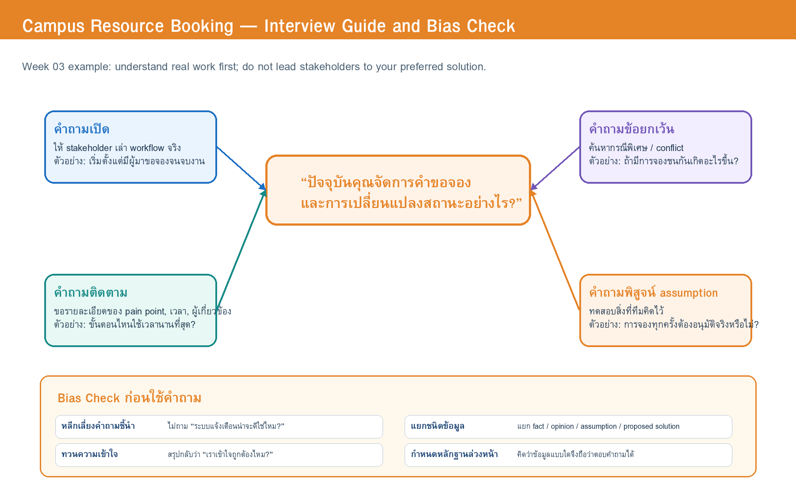

# 03 — Interview Guide and Rehearsal Revision

> Team: Group 00 | Case: Case X — CRBS (Campus Resource Booking) | Target role: เจ้าหน้าที่ทรัพยากร (primary), นักศึกษา / ผู้ขอใช้ (secondary), ผู้จัดการพื้นที่ และผู้ดูแลระบบ IT (คำถามตรวจสมมติฐาน)  
> เวอร์ชัน: v0.2 (หลังซ้อมกับ AI และ peer critique) | วันที่ปรับปรุง: 18/07/2026

## 1. Opening and Consent Script

> ขอบคุณที่ร่วมกิจกรรมจำลองนี้ เราต้องการเรียนรู้กระบวนการจองพื้นที่และอุปกรณ์ในปัจจุบัน เพื่อวิเคราะห์ความต้องการของระบบอย่างเป็นระบบ การสัมภาษณ์ใช้เวลาประมาณ 30 นาที (ตามช่วงเวลาที่ Workshop กำหนด) ข้อมูลที่บันทึกจะใช้เพื่อการเรียนรู้และจะไม่เก็บข้อมูลส่วนบุคคลจริง เราจะจดเฉพาะขั้นตอน กฎ ปัญหา และข้อเสนอที่เกี่ยวข้องกับกรณีศึกษาเท่านั้น คุณมีสิทธิ์ไม่ตอบคำถามใดก็ได้ และหากเราเข้าใจสิ่งใดไม่ถูกต้อง เราจะสรุปกลับเพื่อขอให้ช่วยยืนยัน

## 2. Interview Questions

> **Source:** [`w03-interview-question-map.drawio`](../diagrams/elicitation/w03-interview-question-map.drawio)

| Q ID | EO ID | Main / Follow-up Question | Type | Why / Expected Evidence |
|---|---|---|---|---|
| Q-01 | EO-01, EO-04 | **[Staff]** ปัจจุบันเมื่อมีคนต้องการจองห้องหรืออุปกรณ์ คุณดำเนินการตั้งแต่รับคำขอจนจบงานอย่างไร? | Open | เริ่มจาก workflow จริงโดยไม่บังคับให้พูดถึงระบบใหม่ → ขั้นตอนปัจจุบัน ผู้เกี่ยวข้อง และจุดตัดสินใจ |
| Q-02 | EO-01, EO-03 | **[Staff]** ขั้นตอนใดใช้เวลามากที่สุด หรือทำให้เกิดข้อผิดพลาดบ่อยที่สุด เพราะอะไร? | Probe | ค้นหา pain point และ root cause → ความถี่และผลกระทบ |
| Q-03 | EO-01 | **[Staff]** มีคำขอประเภทใดที่คุณอนุมัติได้ทันที และประเภทใดต้องขออนุมัติจากคนอื่น? | Open + Probe | เก็บเกณฑ์อนุมัติตามประเภททรัพยากร → approval rule, role และเงื่อนไข |
| Q-03a | EO-01 | (follow-up) ครั้งล่าสุดที่อนุมัติทันทีเกิดขึ้นเมื่อไร และเพราะเหตุใด? ข้อมูลใดทำให้คุณมั่นใจว่าควรอนุมัติหรือปฏิเสธ? | Probe | ได้ "เงื่อนไข + ตัวอย่างเหตุการณ์จริง" แทนคำตอบกว้าง (เพิ่มหลังซ้อม) |
| Q-04 | EO-01, EO-02 | **[Staff]** เมื่อมีคำขอจองชนกัน คุณใช้ข้อมูลใดและตัดสินใจอย่างไร? | Exception | หา conflict resolution rule → priority rule, notification need, exception |
| Q-05a | EO-03 | **[Staff]** หากผู้ใช้ยกเลิกช้า (ใกล้เวลาใช้งาน) ปัจจุบันหน่วยงานทำอย่างไร และอะไรเป็นข้อกังวล? | Exception | late cancellation policy, action, fairness concern (แยกจาก Q-05 เดิม) |
| Q-05b | EO-03 | **[Staff]** ถ้าผู้ใช้ไม่มาตามเวลาจอง ทรัพยากรจะถูกนำกลับมาให้คนอื่นใช้เมื่อไร? | Exception | no-show action และเวลาที่ปล่อยทรัพยากร (แยกจาก Q-05 เดิม) |
| Q-06 | EO-04 | **[Staff]** ตอนส่งมอบและรับคืนอุปกรณ์ คุณต้องตรวจหรือบันทึกข้อมูลอะไรบ้าง เพราะอะไร? | Open | ระบุหลักฐานและผู้รับผิดชอบช่วง handover/return → asset condition, record, status update |
| Q-07 | EO-05 | **[Student]** ก่อนตัดสินใจจอง คุณต้องการทราบข้อมูลอะไรเกี่ยวกับห้องหรืออุปกรณ์? | Open | เข้าใจข้อมูลที่ผู้ใช้ต้องใช้ตัดสินใจ → availability, capacity, equipment, location, rules |
| Q-08 | EO-05 | **[Student]** เมื่อสถานะคำขอเปลี่ยน คุณทราบข่าวอย่างไร และปัญหาของช่องทางปัจจุบันคืออะไร? · follow-up: เวลาใดที่คุณต้องทราบสถานะมากที่สุด? ผู้ใช้พลาดสถานะในจุดใดบ่อยที่สุด และผลกระทบคืออะไร? | Open + Probe | เริ่มจากการรับรู้สถานะก่อนถามเรื่องช่องทาง → current channels, timing, missed-status scenarios |
| Q-09 | EO-02 | **[Manager]** หน่วยงานกำหนดระยะเวลาจองล่วงหน้าและระยะเวลาใช้งานอย่างไร? มีเหตุผลหรือข้อยกเว้นใด? | Assumption check | พิสูจน์กฎที่ทีมยังไม่รู้ → policy/rule, exception, decision owner |
| Q-10 | EO-06 | **[IT]** หากใช้บัญชีสถาบัน ระบบควรได้รับข้อมูลใดบ้าง และข้อมูลใดไม่ควรเก็บซ้ำ? · follow-up: ข้อมูลนั้นจะช่วยให้ระบบตัดสินใจเรื่องใด และข้อมูลใดไม่จำเป็น? | Assumption check | ตรวจ A-03 และ privacy/access constraint → authentication data, roles, data minimization |
| Q-11 | ทุก EO | **[All]** ขอสรุปว่า … (ผู้สัมภาษณ์สรุป workflow/rule ที่ได้ยิน) … ถูกต้องไหม? มีส่วนใดต้องแก้หรือเพิ่ม? | Confirm | ทวนความเข้าใจและลด recording bias → confirmed / corrected interpretation (เพิ่มหลังซ้อม) |

### Coverage Check

- [x] role/context (เปิดด้วย §1 + Q-01)
- [x] current work / critical incident (Q-01, Q-03a)
- [x] pain/impact (Q-02, Q-08)
- [x] rule/authority/data (Q-03, Q-06, Q-09, Q-10)
- [x] exception/negative case (Q-04, Q-05a, Q-05b)
- [x] outcome/priority/trade-off (Q-07, Q-08 follow-up "เวลาใดสำคัญที่สุด")
- [x] paraphrase/closing validation (Q-11)

## 3. Bias and Privacy Check

| Q ID | Issue: leading/solution/double/vague/privacy | Neutral revision | Rationale |
|---|---|---|---|
| Q-08 | Leading / solution: "ระบบแจ้งเตือนอัตโนมัติคงช่วยได้ใช่ไหม?" | "เมื่อสถานะเปลี่ยน คุณทราบข่าวอย่างไร และมีจุดใดที่ทำให้คุณพลาดข้อมูล?" | ชวนให้ตอบเห็นด้วยกับ solution ที่ทีมคิดไว้ |
| Q-08 | Solution bias หลังซ้อม: ผู้ตอบเริ่มเสนอ "อยากได้ LINE notification" | เพิ่ม "ปัญหาของช่องทางปัจจุบันคืออะไร?" และ "เวลาใดที่ต้องทราบสถานะมากที่สุด?" | เสี่ยงจด solution เป็น requirement ทันที (peer critique: Group 00C) |
| Q-03 | Leading: "ทุกการจองควรให้เจ้าหน้าที่อนุมัติใช่ไหม?" | "มีคำขอประเภทใดที่คุณอนุมัติได้ทันที และประเภทใดต้องขออนุมัติ?" | ตีความกฎล่วงหน้าและอาจสร้าง workflow ที่ไม่จำเป็น |
| Q-05 | Double-barrelled: รวม late cancellation กับ no-show ในข้อเดียว | แยกเป็น Q-05a และ Q-05b | ผู้ตอบพูดถึง no-show อย่างเดียว (ซ้อม) · peer critique: Group 00B |
| Q-06 | Solution: "ถ่ายรูปตอนคืนอุปกรณ์น่าจะปลอดภัยกว่าหรือไม่?" | "ตอนรับคืนอุปกรณ์ คุณต้องตรวจหรือบันทึกข้อมูลอะไรบ้าง เพราะอะไร?" | เสนอวิธีแก้ก่อนรู้ความจำเป็น |
| Q-10 | Privacy: คำถามเรื่องบัญชีผู้ใช้อาจทำให้ถามถึงข้อมูลจริง | ถามเฉพาะ "ข้อมูลใดจำเป็น และข้อมูลใดไม่ควรเก็บซ้ำ" ไม่ขอตัวอย่างข้อมูลจริง | data minimization ตาม CT-02 |

### Team assumptions to watch

| Assumption | Risk if wrong | How the team will test it |
|---|---|---|
| ทุกการจองต้องผ่านเจ้าหน้าที่ | Workflow อาจซับซ้อนเกินจริง | ถาม Q-03 และตรวจเอกสารนโยบาย |
| ผู้ใช้ต้องการแจ้งเตือนทันทีทุกสถานะ | อาจทำให้แจ้งเตือนมากเกินไป | ถาม Q-08 เกี่ยวกับช่วงเวลาที่สำคัญจริง |
| การคืนอุปกรณ์ต้องมีภาพถ่ายเสมอ | อาจเพิ่มภาระโดยไม่จำเป็น | ถาม Q-06 และดูเหตุผลของหลักฐานที่ต้องการ |
| บัญชีสถาบันส่ง role ได้ครบทุกคน | อาจไม่ครอบคลุมผู้ใช้บางกลุ่ม | ถาม Q-10 กับ IT proxy |

### Information still without evidence

- เงื่อนไขอนุมัติรายทรัพยากร
- ระยะเวลาจองล่วงหน้าและกฎ no-show
- หลักฐานรับ–คืนที่เพียงพอ
- ช่องทางแจ้งเตือนที่เหมาะสมและความถี่ที่ไม่รบกวนผู้ใช้

### How the team will avoid bias

1. เริ่มด้วยคำถามเปิดเกี่ยวกับงานจริงก่อนพูดถึง solution
2. จดข้อความ/เหตุการณ์พร้อม source ให้ตรวจสอบย้อนกลับได้
3. แยกสิ่งที่ stakeholder **บอกว่าเกิดขึ้น** ออกจากสิ่งที่ทีม **ตีความ**
4. ทวนความเข้าใจด้วย Q-11 ก่อนจบแต่ละ stakeholder simulation
5. เปรียบเทียบข้อมูลจากอย่างน้อยสองแหล่งเมื่อเป็นกฎสำคัญ

## 4. AI Interview Rehearsal

- Role/prompt used: Prompt Pack W03 ส่วน A (Role Prompt) บทบาท **เจ้าหน้าที่ทรัพยากร** 1 บทบาท — ใส่เฉพาะ Case facts และ goal/concern/authority จาก profile ใน `docs/02` §1.1 (prompt ที่ใช้จริงอยู่ในไฟล์ rehearsal notes)
- Session/evidence path: [`evidence/week-03/ai-interview-rehearsal-notes.md`](../evidence/week-03/ai-interview-rehearsal-notes.md) (14/07/2026) · ซ้อมคำถาม IT กับเพื่อนเพิ่มเติม: [`evidence/week-03/question-rehearsal-notes.md`](../evidence/week-03/question-rehearsal-notes.md)
- Simulation limitation: AI ไม่รู้กฎจริงของหน่วยงาน และอาจเติมรายละเอียดเอง — ทีมใช้ผลซ้อมเพื่อแก้ **คำถาม** เท่านั้น ไม่ใช้เป็น evidence หรือ requirement

| Q ID | What happened | Useful probe / problem | Revised question |
|---|---|---|---|
| Q-03 | Stakeholder proxy (AI) ตอบว่า "บางครั้งก็อนุมัติเลย" แต่ยังไม่ชัดว่า "บางครั้ง" หมายถึงอะไร | คำถามยังไม่ขอเงื่อนไขและตัวอย่าง | เพิ่ม Q-03a: "ครั้งล่าสุดที่อนุมัติทันทีเกิดขึ้นเมื่อไร และเพราะเหตุใด? ข้อมูลใดทำให้มั่นใจว่าควรอนุมัติหรือปฏิเสธ?" |
| Q-05 | ผู้ตอบพูดถึง no-show แต่ไม่กล่าวถึง late cancellation | คำถามรวมสองเหตุการณ์มากเกินไป | แยกเป็น Q-05a late cancellation และ Q-05b no-show |
| Q-08 | ผู้ตอบเริ่มเสนอ "อยากได้ LINE notification" | เสี่ยง solution bias ถ้าทีมจดเป็น requirement ทันที | เพิ่ม "ปัญหาของช่องทางปัจจุบันคืออะไร?" และ "เวลาใดที่ต้องทราบสถานะมากที่สุด?" |
| Q-10 (ซ้อมกับเพื่อน) | IT proxy ตอบเชิงเทคนิคเร็วเกินไป | Interviewer อาจไม่เข้าใจผลกระทบต่อ role/data | เพิ่ม follow-up: "ข้อมูลนั้นจะช่วยให้ระบบตัดสินใจเรื่องใด และข้อมูลใดไม่จำเป็น?" |
| (ทั้งชุด) | จบการซ้อมโดยไม่มีการทวนความเข้าใจ | เสี่ยง recording bias | เพิ่ม Q-11 สำหรับทวนความเข้าใจตอนท้าย |

## 5. Ready for Week 04

- Questions retained: Q-01, Q-02, Q-04, Q-06, Q-07, Q-09
- Questions removed/revised: Q-03 (+ Q-03a) · Q-05 → Q-05a/Q-05b · Q-08 (เริ่มจากการรับรู้สถานะและเวลาที่สำคัญ) · Q-10 (+ follow-up) · เพิ่ม Q-11 · ไม่มีคำถามที่ตัดทิ้ง
- Information the simulated role did not know: เกณฑ์อนุมัติรายทรัพยากรที่ชัดเจน (ตอบเพียง "บางครั้ง") · หลักฐานรับ–คืนระดับใดเพียงพอ · กฎจองล่วงหน้าและ no-show (เป็นเรื่องของผู้จัดการพื้นที่)
- Open issues / verification needed: OQ-01–OQ-05 และ A-03 ยังไม่มี evidence · ถ้าข้อมูลจากเจ้าหน้าที่กับผู้จัดการพื้นที่ขัดกัน ต้องบันทึกเป็น conflict ไม่เลือกทางใดทางหนึ่งเอง · Week 04 ใช้ E-ID เรียงลำดับ (E-01, E-02, …) และระบุบทบาทในคอลัมน์ source
