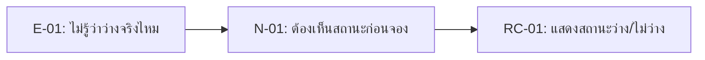

# 04 — Requirement Candidates: Campus Resource Booking (CRBS)

> **ที่มา (repo ตัวอย่าง):** เนื้อหาส่วนใหญ่ดัดแปลงจากตัวอย่าง CRBS ของผู้สอนใน Course Repo `campus_resource_booking_case/week04-campus-resource-booking-example/docs/04-requirement-candidates.md` — กลุ่มจริงต้องเขียนจาก case และหลักฐานของกลุ่มเอง

> **Week 4 deliverable** · แปลง evidence (E-ID) จาก `docs/04-evidence-log.md` เป็น requirement candidate — ยังไม่ใช่ requirement จริง

## 1. วิธีที่ทีมแปลง evidence เป็น candidate

1. เริ่มจาก evidence ที่มี E-ID
2. เขียน need เป็นปัญหา/เป้าหมายของ stakeholder (N-ID)
3. เขียน RC เป็น capability ของระบบ
4. ใส่ status เป็น `Candidate` หรือ `Needs Validation`
5. ระบุ follow-up ถ้ายังมี unknown

## 2. Requirement Candidate Table

| RC-ID | Requirement Candidate | Stakeholder / Need | Evidence E-ID(s) | Status | Follow-up |
|---|---|---|---|---|---|
| RC-01 | The system should show availability status for rooms and learning equipment before a user submits a booking request. | Student Requester / N-01 | E-01 | Candidate | Verify source of availability status (OQ-08) |
| RC-02 | The system should allow users to search and filter resources by resource type and availability so that they can choose a suitable resource before requesting it. | Student Requester / N-02 | E-02 | Candidate | Confirm search/filter fields |
| RC-03 | The system should display expected return date/time for borrowed equipment to both requester and resource officer. | Student Requester, Resource Officer / N-03 | E-03 | Candidate | Confirm due-date rule |
| RC-04 | The system should require minimum booking information before a request can be submitted for review. | Resource Officer / N-04 | E-04 | Candidate | Confirm required fields |
| RC-05 | The system should mark urgent or schedule-conflicting requests as needing manager/instructor validation before approval. | Resource Officer / N-05 | E-05 | Needs Validation | Confirm approval authority (OQ-01) |

## 3. ทำไมยังเป็น candidate ไม่ใช่ requirement จริง

| RC | เหตุผลที่ยังไม่ final |
|---|---|
| RC-01 | ยังไม่รู้ว่า availability จะ sync จากแหล่งข้อมูลใด (OQ-08) |
| RC-02 | field ค้นหาที่จำเป็นยังมาจากบทบาทจำลองเพียงบทบาทเดียว |
| RC-03 | ยังไม่รู้กฎวันคืนและวิธีแจ้งเตือน (OQ-05) |
| RC-04 | รายการข้อมูลขั้นต่ำยังเป็นข้อตกลงชั่วคราวจาก C-01 (Provisional) |
| RC-05 | ยังไม่รู้ authority ที่อนุมัติ exception จริง (C-02 Escalate, OQ-01) |

## 4. ส่งต่อ Week 05 Backlog

| Week04 RC | ย้ายไป Week05? | เหตุผล |
|---|---|---|
| RC-01 | Yes | Evidence ชัดและเป็น core flow |
| RC-02 | Yes | ช่วยลดการถามเจ้าหน้าที่ซ้ำ |
| RC-03 | Yes, revise after validation | ต้องยืนยัน rule วันคืน |
| RC-04 | Yes | เป็นเงื่อนไขการทำงานที่เจ้าหน้าที่จำลองระบุ (E-04 tag `SN`) — รายการ field ยังต้องยืนยัน |
| RC-05 | Revise | ต้องถามผู้มีอำนาจก่อนเขียนให้ชัด |
| E-06 (unknown) | Hold | ไม่เขียนกฎโควตา/ระยะเวลาจองจนกว่าจะมีเจ้าของคำตอบ (OQ-02, OQ-07) |

## 5. สิ่งที่ทีมเรียนรู้

RC ที่ดีควรตอบได้ว่า: อ้าง evidence ไหน · แก้ need อะไร · ยังไม่รู้อะไร · จะตรวจต่อใน Week05 อย่างไร
