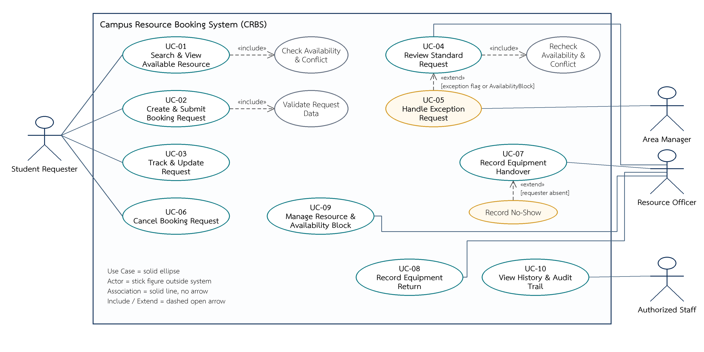
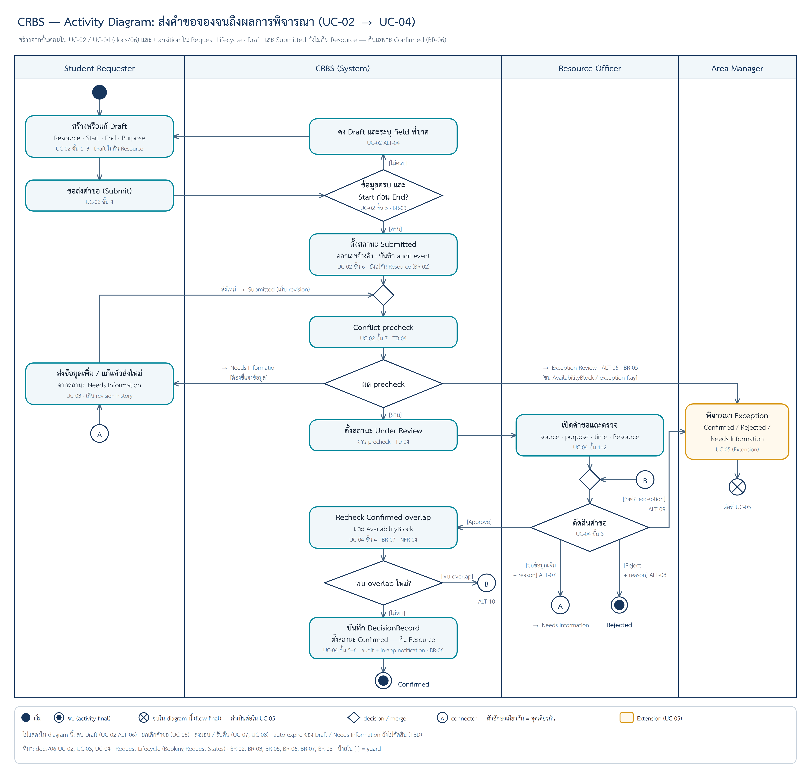

# 06 — Requirement Models: User Stories, Use Cases and Acceptance Criteria

> **Week 6 deliverable** · Model Pack `CRBS-SYSTEM-MODEL-PACK-v1.0` · สถานะ: ส่งต่อ W07 (ยังไม่ผ่าน validation ของ W08)  
> Input: [`05-requirement-backlog.md`](05-requirement-backlog.md) ที่ล็อกใน tag `baseline-v1.0` — 15 FR / 10 BR / 8 NFR / 13 DR  
> Case: CRBS — Campus Resource Booking (Case X, teaching case) · กติกา `TD-*` เป็น Authorized Teaching Decision เพื่อการสอน ไม่ใช่นโยบายจริงของมหาวิทยาลัย (ข้อความ TD อยู่ใน `docs/05` หัวข้อ 1.2)

## ขอบเขตของ Model

- แสดง System View ครบ 10 Use Cases และเขียนรายละเอียด 6 Use Cases (UC-01, UC-02, UC-04, UC-05, UC-07, UC-08) ที่เป็นตัวแทนวงจรตั้งแต่ค้นหาจนรับคืน
- Model อธิบาย observable behavior — **ไม่ออกแบบ** หน้าจอ, API, database หรือ architecture
- ค่าเวลาหรือ policy ที่ยังเป็น TBD ไม่ถูกเติมเพื่อให้ model ดูสมบูรณ์
- ชุดนี้มี 12 US / 10 UC / 24 AC ซึ่งเกินขั้นต่ำ Student Core (2 US · 1 Detailed UC · 3 AC)
- Authorized Staff ใน W06 เป็น role abstraction ภายใต้ NFR-02 ไม่ใช่ persona ใหม่

## 1. User Stories

> Priority ใช้ตาม FR ที่เชื่อมใน `docs/05` · AC ที่ระบุ Partial = ยังไม่มี AC เฉพาะ ต้องส่งต่อเป็น verification gap (ไม่แต่ง AC เพิ่มเงียบ ๆ)

| ID | User Story | Priority | Linked FR / BR | Acceptance Criteria |
|---|---|---|---|---|
| US-01 | ในฐานะ **Student Requester** ฉันต้องการค้นหาทรัพยากรที่ว่างตามประเภทและช่วงเวลา เพื่อเลือกตัวเลือกก่อนสร้างคำขอ | Must | FR-01 | AC-01, AC-02, AC-03, AC-04 |
| US-02 | ในฐานะ **Student Requester** ฉันต้องการดูรายละเอียด สถานะ และเงื่อนไขของทรัพยากร เพื่อตัดสินใจได้ว่าทรัพยากรเหมาะกับงาน | Must | FR-02 | AC-01, AC-03 |
| US-03 | ในฐานะ **Student Requester** ฉันต้องการบันทึกและแก้ Draft request เพื่อเตรียมข้อมูลโดยยังไม่กันทรัพยากร | Must | FR-03, BR-01, BR-02 | AC-05, AC-08 |
| US-04 | ในฐานะ **Student Requester** ฉันต้องการส่งคำขอที่ข้อมูลครบ เพื่อให้คำขอเข้าสู่การพิจารณาและมีเลขอ้างอิง | Must | FR-04, BR-03 | AC-05, AC-06, AC-07 |
| US-05 | ในฐานะ **Student Requester** ฉันต้องการดูสถานะและประวัติคำขอ เพื่อรู้ว่าควรรอ ให้ข้อมูลเพิ่ม หรือดำเนินการอะไร | Must | FR-05 | Partial — ยังไม่มี AC เฉพาะ (UC-03 เป็น Summary) |
| US-06 | ในฐานะ **Student Requester** ฉันต้องการส่งข้อมูลเพิ่มเมื่อเจ้าหน้าที่ร้องขอ เพื่อทำให้คำขอกลับเข้าสู่การพิจารณาได้ | Must | FR-05, BR-08 | Partial — AC-10, AC-15 ตรวจเฉพาะการตั้ง Needs Information; การส่งข้อมูลกลับยังไม่มี AC |
| US-07 | ในฐานะ **Student Requester** ฉันต้องการยกเลิกคำขอที่ยังมีสิทธิ์ยกเลิก เพื่อปล่อยทรัพยากรและรักษาประวัติการตัดสินใจ | Should | FR-08, BR-09 | Partial — ยังไม่มี AC (UC-06 เป็น Summary) |
| US-08 | ในฐานะ **Resource Officer** ฉันต้องการตรวจและตัดสิน standard request เพื่อจัดสรรทรัพยากรด้วยข้อมูลและ conflict check | Must | FR-06, BR-04, BR-06, BR-07, BR-08 | AC-09, AC-10, AC-11, AC-12 |
| US-09 | ในฐานะ **Area Manager** ฉันต้องการพิจารณา exception request พร้อมผลกระทบ เพื่อตัดสินกรณีพิเศษอย่างมีเหตุผลและตรวจย้อนหลังได้ | Should | FR-07, BR-05, BR-08 | AC-13, AC-14, AC-15, AC-16 |
| US-10 | ในฐานะ **Resource Officer** ฉันต้องการบันทึกการส่งมอบอุปกรณ์ เพื่อรู้ผู้รับผิดชอบและกำหนดคืน | Must | FR-12, BR-10 | AC-17, AC-18, AC-19, AC-20 |
| US-11 | ในฐานะ **Resource Officer** ฉันต้องการบันทึกการรับคืนและสภาพโดยสรุป เพื่อปิดวงจรการใช้และส่งต่อข้อมูลสภาพทรัพยากร | Must | FR-13, BR-10 | AC-21, AC-22, AC-23, AC-24 |
| US-12 | ในฐานะ **Authorized Staff** ฉันต้องการดูประวัติคำขอและ audit events เพื่อตรวจว่าใครเปลี่ยนอะไรเมื่อใดและเพราะเหตุใด | Should | FR-15, NFR-03 | Partial — ไม่มี AC เฉพาะ · audit ถูกตรวจร่วมใน Then ของ AC-09, AC-11, AC-13, AC-17, AC-19, AC-21 (AC-11 ตรวจ reason / actor / time) · ส่วนที่เหลือตรวจด้วย review ของ audit fields (NFR-03 / TD-17) · gap: AC-05, AC-07, AC-10, AC-14, AC-15 เปลี่ยนสถานะแต่ Then ไม่ตรวจ audit และการยกเลิกยังไม่มี AC |

## 2. Acceptance Criteria

> 24 ข้อ เขียนแบบ Given / When / Then · Coverage ชี้กลับไปยัง UC step หรือ alternate flow (ALT) และ BR ที่ตรวจ

### AC-01 — ค้นหาพบ Resource ที่ว่าง

- **Given** มี Resource active และว่างตรง type/time
- **When** Requester ค้นหาด้วยเงื่อนไขครบ
- **Then** Resource ปรากฏพร้อม status/time ที่ตรง
- Coverage: UC-01 Main

### AC-02 — Confirmed request ทับช่วงค้นหา

- **Given** Resource มี Confirmed request ทับช่วงค้นหา
- **When** Requester ค้นหาช่วงนั้น
- **Then** Resource ไม่ปรากฏเป็น Available
- Coverage: UC-01 Step 4, BR-06, BR-07

### AC-03 — AvailabilityBlock ทับช่วงค้นหา

- **Given** Resource มี AvailabilityBlock ทับช่วงค้นหา
- **When** Requester ค้นหาช่วงนั้น
- **Then** Resource ไม่ปรากฏเป็น Available และไม่เปิดเผยข้อมูล block เกินสิทธิ์
- Coverage: UC-01 Step 4

### AC-04 — เงื่อนไขเวลาไม่ครบหรือไม่สมเหตุผล

- **Given** Start/End ไม่ครบ หรือ Start ไม่ก่อน End
- **When** Requester ขอค้นหา
- **Then** ระบบไม่ค้นหาและระบุเงื่อนไขเวลาที่ต้องแก้
- Coverage: UC-01 ALT-01

### AC-05 — Submit Draft ที่ข้อมูลครบ

- **Given** Draft มี Resource / Start / End / Purpose ครบ
- **When** Requester Submit
- **Then** ได้ reference number และสถานะ Submitted โดยยังไม่กัน Resource
- Coverage: UC-02 Main, BR-02, BR-03

### AC-06 — Submit โดยขาด Purpose

- **Given** Draft ขาด Purpose
- **When** Requester Submit
- **Then** ระบบคง Draft และระบุว่า Purpose ขาด
- Coverage: UC-02 ALT-04

### AC-07 — คำขอชน AvailabilityBlock

- **Given** Request ชน AvailabilityBlock
- **When** System ทำ precheck หลัง Submit
- **Then** Request ไป Exception Review พร้อม block reference/reason
- Coverage: UC-02 ALT-05, BR-05

### AC-08 — ลบ Draft ของตน

- **Given** Requester เป็นเจ้าของ Draft
- **When** Requester ลบ Draft
- **Then** Draft ถูกยุติและ availability ไม่เปลี่ยน
- Coverage: UC-02 ALT-06

### AC-09 — Officer อนุมัติคำขอที่ไม่มี overlap/block

- **Given** Under Review request ไม่มี overlap/block
- **When** Officer Approve
- **Then** ระบบ recheck แล้วตั้ง Confirmed พร้อม Decision/Audit
- Coverage: UC-04 Main

### AC-10 — Officer ขอข้อมูลเพิ่ม

- **Given** Under Review request ต้องมีข้อมูลเพิ่ม
- **When** Officer เลือก Needs Information พร้อม reason
- **Then** สถานะเปลี่ยนและ Requester ได้ in-app notification
- Coverage: UC-04 ALT-07

### AC-11 — Officer ปฏิเสธคำขอ

- **Given** Under Review request ไม่ผ่านการพิจารณา
- **When** Officer Reject พร้อม reason
- **Then** สถานะ Rejected และบันทึก reason/actor/time
- Coverage: UC-04 ALT-08

### AC-12 — พบ Confirmed overlap หลังเปิด review

- **Given** พบ Confirmed overlap หลังเปิด review
- **When** Officer Approve
- **Then** ระบบไม่ Confirm และแสดง conflict ให้ทบทวน
- Coverage: UC-04 ALT-10, NFR-04

### AC-13 — Manager อนุมัติ exception

- **Given** Exception Review มี impact summary
- **When** Manager Approve พร้อม rationale และไม่มี overlap
- **Then** สถานะ Confirmed พร้อม Decision/Audit
- Coverage: UC-05 Main

### AC-14 — Manager ปฏิเสธ exception

- **Given** Manager ปฏิเสธ exception
- **When** Manager ระบุ reason และยืนยัน
- **Then** สถานะ Rejected และแจ้ง Requester/Officer
- Coverage: UC-05 ALT-11

### AC-15 — Manager ขอข้อมูลเพิ่ม

- **Given** Exception ขาดข้อมูลที่ใช้ตัดสิน
- **When** Manager Request More Information พร้อม reason
- **Then** สถานะ Needs Information และแจ้ง Requester
- Coverage: UC-05 ALT-12

### AC-16 — Exception มี Confirmed overlap

- **Given** Exception มี Confirmed overlap
- **When** Manager พยายาม Approve
- **Then** ระบบไม่ Confirm และไม่ auto override
- Coverage: UC-05 ALT-13

### AC-17 — บันทึก Check Out

- **Given** Confirmed equipment request รอส่งมอบ
- **When** Officer ระบุ responsible requester/due time และยืนยัน
- **Then** Fulfillment เป็น Checked Out พร้อม audit
- Coverage: UC-07 Main

### AC-18 — Check Out ขาดข้อมูลขั้นต่ำ

- **Given** responsible requester หรือ due time ขาด
- **When** Officer ยืนยัน Check Out
- **Then** ระบบไม่บันทึกและระบุข้อมูลที่ขาด
- Coverage: UC-07 ALT-14

### AC-19 — บันทึก No Show โดยไม่มี penalty

- **Given** Confirmed request มี no-show teaching event
- **When** Officer บันทึก No Show
- **Then** Fulfillment เป็น No Show มี audit แต่ไม่มี penalty
- Coverage: UC-07 ALT-15

### AC-20 — ห้ามส่งมอบคำขอที่ Cancelled/Rejected

- **Given** Request ถูก Cancelled หรือ Rejected
- **When** Officer พยายาม Check Out
- **Then** ระบบปฏิเสธการส่งมอบ
- Coverage: UC-07 ALT-16

### AC-21 — บันทึก Return

- **Given** Checked Out record มี returned time/condition ครบ
- **When** Officer ยืนยัน Return
- **Then** Fulfillment เป็น Returned พร้อม audit/notification
- Coverage: UC-08 Main

### AC-22 — Return ขาด condition summary

- **Given** condition summary ขาด
- **When** Officer ยืนยัน Return
- **Then** ระบบไม่บันทึก Return และระบุข้อมูลที่ขาด
- Coverage: UC-08 ALT-17

### AC-23 — ไฟล์แนบไม่ผ่านเงื่อนไข

- **Given** Optional attachment ไม่ผ่านเงื่อนไข
- **When** Officer บันทึก Return
- **Then** ระบบปฏิเสธไฟล์แนบ แต่ยังให้แก้/ส่งข้อมูลขั้นต่ำได้
- Coverage: UC-08 ALT-18

### AC-24 — บันทึก condition concern โดยไม่สร้าง maintenance workflow

- **Given** Officer ระบุ condition concern ว่าชำรุด
- **When** Officer ยืนยัน Return
- **Then** ระบบเก็บ concern ใน record และไม่สร้าง maintenance workflow ที่อยู่นอก scope
- Coverage: UC-08 ALT-19

## 3. Use Case List

| ID | Use Case | Primary Actor | Goal | Related FR / BR / NFR | Level | Diagram |
|---|---|---|---|---|---|---|
| UC-01 | Search and View Available Resource | Student Requester | เห็นทรัพยากรที่ว่างและรายละเอียดก่อนสร้างคำขอ | FR-01, FR-02, FR-11 | Detailed / Core path | [Use case overview](../diagrams/use-case/w06-use-case-overview.png) |
| UC-02 | Create and Submit Booking Request | Student Requester | สร้าง Draft และส่งคำขอหนึ่ง Resource หนึ่งช่วงเวลา | FR-03, FR-04; BR-01–BR-03 | Detailed / Core path | [Use case overview](../diagrams/use-case/w06-use-case-overview.png) · [Activity](../diagrams/activity/w06-submit-review-activity.png) |
| UC-03 | Track and Update Request Information | Student Requester | ติดตามสถานะ/timeline และส่งข้อมูลเพิ่มเมื่อ Needs Information | FR-05, FR-09 | Summary | [Use case overview](../diagrams/use-case/w06-use-case-overview.png) |
| UC-04 | Review and Decide Standard Request | Resource Officer | ตัดสิน standard request โดยตรวจข้อมูลและ conflict ก่อน Confirmed | FR-06; BR-04, BR-06–BR-08; NFR-04 | Detailed / Core path | [Use case overview](../diagrams/use-case/w06-use-case-overview.png) · [Activity](../diagrams/activity/w06-submit-review-activity.png) |
| UC-05 | Handle Exception Request | Area Manager | ตัดสิน exception โดยเห็นเหตุผลและผลกระทบ | FR-07; BR-05, BR-08 | Detailed / Extension | [Use case overview](../diagrams/use-case/w06-use-case-overview.png) |
| UC-06 | Cancel Booking Request | Student Requester | ยกเลิกคำขอที่ยังยกเลิกได้ พร้อมเหตุผลเมื่อ Confirmed | FR-08; BR-09 | Summary | [Use case overview](../diagrams/use-case/w06-use-case-overview.png) |
| UC-07 | Record Equipment Handover | Resource Officer | บันทึกการส่งมอบอุปกรณ์ให้ผู้รับผิดชอบ | FR-12, FR-14; BR-10 | Detailed / Core path | [Use case overview](../diagrams/use-case/w06-use-case-overview.png) |
| UC-08 | Record Equipment Return | Resource Officer | บันทึกการรับคืนและสภาพโดยสรุปเพื่อปิดวงจร fulfillment | FR-13; BR-10 | Detailed / Core path | [Use case overview](../diagrams/use-case/w06-use-case-overview.png) |
| UC-09 | Manage Resource and Availability Block | Resource Officer | สร้าง/แก้ Resource และ AvailabilityBlock พร้อม source/reason | FR-10, FR-11 | Summary / Supporting | [Use case overview](../diagrams/use-case/w06-use-case-overview.png) |
| UC-10 | View Request History and Audit Trail | Authorized Staff | ดู request history และ audit events ตามสิทธิ์ | FR-15; NFR-02, NFR-03 | Summary / Supporting | [Use case overview](../diagrams/use-case/w06-use-case-overview.png) |

## 4. Use Case Specification

> เขียนรายละเอียด 6 Use Cases · ใน Main Success Scenario ระบุ lane ว่าเป็น **Actor** หรือ **System** · ALT-ID ใช้ร่วมกับ AC ในหัวข้อ 2

### UC-01 — Search and View Available Resource

| Field | Detail |
|---|---|
| Primary Actor | Student Requester |
| Goal | เห็นทรัพยากรที่ว่างและรายละเอียดที่เกี่ยวข้องก่อนสร้างคำขอ |
| Trigger | Actor ต้องการใช้ทรัพยากรในช่วงเวลาหนึ่ง |
| Preconditions | Resource data และ availability fixtures พร้อม; actor เข้าถึง catalog ได้ |
| Main Success Scenario | 1. **Actor** ระบุ resource type, start และ end 2. **System** ตรวจว่าเงื่อนไขครบและ start อยู่ก่อน end 3. **Actor** ส่งคำสั่งค้นหา 4. **System** ตรวจ Resource ที่ active และไม่มี Confirmed request หรือ AvailabilityBlock ทับช่วงเวลา 5. **System** แสดงตัวเลือกพร้อม status, location และข้อมูลใช้งานที่มี source 6. **Actor** เลือก Resource เพื่อดูรายละเอียดหรือเริ่ม Draft request |
| Alternate / Exception Flows | ALT-01 ที่ Step 2: เวลาไม่ครบหรือไม่สมเหตุผล ระบบไม่ค้นหาและระบุข้อมูลที่ต้องแก้ ALT-02 ที่ Step 4: ไม่พบตัวเลือก ระบบแจ้งไม่พบและให้ปรับเงื่อนไข ALT-03 ที่ Step 5: Resource detail บางค่ามีสถานะ TBD ระบบไม่แสดงค่าที่เดาและแสดงเฉพาะข้อมูลที่ยืนยันใน Teaching Case |
| Postconditions | Actor เห็นรายละเอียดตัวเลือก; ยังไม่มี Booking Request |
| Related Requirements | FR-01, FR-02, FR-11 · BR-06, BR-07 |
| Source | F-01–F-03; E-01, E-02 → N-01, N-02; OQ-08; TD-01, TD-16 |
| Acceptance Criteria | AC-01, AC-02, AC-03, AC-04 |

### UC-02 — Create and Submit Booking Request

| Field | Detail |
|---|---|
| Primary Actor | Student Requester |
| Goal | สร้าง Draft และส่งคำขอหนึ่ง Resource หนึ่งช่วงเวลา |
| Trigger | Actor เลือกสร้างคำขอจาก Resource หรือเริ่ม Draft ใหม่ |
| Preconditions | Actor ผ่าน identity reference; Resource ยัง active |
| Main Success Scenario | 1. **Actor** สร้าง Draft สำหรับ Resource และช่วงเวลาที่เลือก 2. **System** บันทึก Draft โดยไม่กัน Resource 3. **Actor** กรอกหรือแก้ start, end และ purpose 4. **Actor** ขอส่งคำขอ 5. **System** ตรวจ required fields และ time validity 6. **System** เปลี่ยน Draft เป็น Submitted สร้าง reference number และ audit event 7. **System** ทำ conflict precheck และส่งไป Under Review, Exception Review หรือ Needs Information ตามผล |
| Alternate / Exception Flows | ALT-04 ที่ Step 5: required field ขาด ระบบคง Draft และระบุ field ที่ขาด ALT-05 ที่ Step 7: พบ AvailabilityBlock ระบบส่ง Exception Review พร้อมเหตุผลของ block ALT-06 ก่อน Step 4: Actor ลบ Draft ระบบยุติ Draft โดยไม่กระทบ availability |
| Postconditions | Request เป็น Submitted มี reference number และ audit event; **ยังไม่กัน Resource** |
| Related Requirements | FR-03, FR-04 · BR-01, BR-02, BR-03 |
| Source | TD-01–TD-04 |
| Acceptance Criteria | AC-05, AC-06, AC-07, AC-08 |

### UC-04 — Review and Decide Standard Request

| Field | Detail |
|---|---|
| Primary Actor | Resource Officer |
| Goal | ตัดสิน standard request โดยตรวจข้อมูลและ conflict ก่อน Confirmed |
| Trigger | Officer เปิด request จาก review queue |
| Preconditions | Request อยู่ Under Review; actor มี Officer role ในหน่วยงาน |
| Main Success Scenario | 1. **Actor** เปิด request และตรวจ source, purpose, time และ Resource 2. **System** แสดงข้อมูลคำขอ ผล precheck และประวัติที่เกี่ยวข้องตามสิทธิ์ 3. **Actor** เลือก Approve standard request 4. **System** ตรวจ Confirmed overlap และ AvailabilityBlock อีกครั้ง 5. **System** บันทึก DecisionRecord และเปลี่ยน request เป็น Confirmed 6. **System** สร้าง audit event และ in-app notification ให้ Requester |
| Alternate / Exception Flows | ALT-07 ที่ Step 3: Actor ขอข้อมูลเพิ่มพร้อม reason ระบบตั้ง Needs Information และแจ้ง Requester ALT-08 ที่ Step 3: Actor ปฏิเสธพร้อม reason ระบบตั้ง Rejected และแจ้ง Requester ALT-09 ที่ Step 3: Actor ส่งต่อ exception พร้อม reason ระบบตั้ง Exception Review ALT-10 ที่ Step 4: พบ overlap ใหม่ ระบบไม่ Confirm และให้ Actor ทบทวน/ส่งต่อ/ปฏิเสธตามเหตุผล |
| Postconditions | Request เป็น Confirmed, Rejected, Needs Information หรือถูกส่ง Exception Review พร้อม decision/audit record |
| Related Requirements | FR-06 · BR-04, BR-06, BR-07, BR-08 · NFR-04 |
| Source | TD-05, TD-07–TD-10 |
| Acceptance Criteria | AC-09, AC-10, AC-11, AC-12 |

### UC-05 — Handle Exception Request

| Field | Detail |
|---|---|
| Primary Actor | Area Manager |
| Goal | ตัดสิน exception โดยเห็นเหตุผลและผลกระทบ |
| Trigger | Manager เปิดรายการ exception |
| Preconditions | Request อยู่ Exception Review; actor มี Manager authority ใน Teaching Case |
| Main Success Scenario | 1. **Actor** เปิด exception request 2. **System** แสดง request, exception reason, conflict/block และ impact summary 3. **Actor** บันทึก rationale และเลือก Approve Exception 4. **System** ตรวจ Confirmed overlap อีกครั้ง 5. **System** บันทึก decision และเปลี่ยนเป็น Confirmed 6. **System** สร้าง audit และแจ้ง Requester/Officer |
| Alternate / Exception Flows | ALT-11 ที่ Step 3: Reject Exception ต้องมี reason แล้วระบบตั้ง Rejected ALT-12 ที่ Step 3: Request More Information ต้องมี reason แล้วระบบตั้ง Needs Information ALT-13 ที่ Step 4: พบ Confirmed overlap ระบบไม่อนุญาต Approve จนกว่าจะเลือกเวลา/Resource อื่น; ไม่มี auto override |
| Postconditions | Confirmed หรือ Rejected พร้อม reason, DecisionRecord, audit และ notification |
| Related Requirements | FR-07 · BR-05, BR-08 |
| Source | TD-06, TD-07, TD-09, TD-10 |
| Acceptance Criteria | AC-13, AC-14, AC-15, AC-16 |

### UC-07 — Record Equipment Handover

| Field | Detail |
|---|---|
| Primary Actor | Resource Officer |
| Goal | บันทึกการส่งมอบอุปกรณ์ให้ผู้รับผิดชอบ |
| Trigger | Requester มารับอุปกรณ์ |
| Preconditions | Request Confirmed และ fulfillment เป็น Awaiting Handover |
| Main Success Scenario | 1. **Actor** เปิด Confirmed request ที่รอส่งมอบ 2. **System** แสดง Resource, requester และช่วงเวลาของคำขอ 3. **Actor** ยืนยัน responsible requester และ due time 4. **System** ตรวจข้อมูลขั้นต่ำและสถานะ fulfillment 5. **Actor** ยืนยันการส่งมอบ 6. **System** บันทึก Checked Out, audit event และ notification |
| Alternate / Exception Flows | ALT-14 ที่ Step 4: responsible requester หรือ due time ขาด ระบบไม่บันทึก Check Out ALT-15 ก่อน Step 3: ไม่มารับตาม teaching event ระบบให้ Officer บันทึก No Show โดยไม่มี penalty ALT-16 ที่ Step 2: request ถูก Cancelled/Rejected ระบบไม่อนุญาตส่งมอบ |
| Postconditions | Fulfillment เป็น Checked Out พร้อม responsible requester, checkout time และ due time |
| Related Requirements | FR-12, FR-14 · BR-10 |
| Source | TD-12, TD-14 |
| Acceptance Criteria | AC-17, AC-18, AC-19, AC-20 |

### UC-08 — Record Equipment Return

| Field | Detail |
|---|---|
| Primary Actor | Resource Officer |
| Goal | บันทึกการรับคืนและสภาพโดยสรุปเพื่อปิดวงจร fulfillment |
| Trigger | มีการนำอุปกรณ์กลับมาคืน |
| Preconditions | Fulfillment อยู่ Checked Out |
| Main Success Scenario | 1. **Actor** เปิด Checked Out record 2. **System** แสดง responsible requester, checkout time และ due time 3. **Actor** บันทึก returned time และ condition summary 4. **System** ตรวจข้อมูลขั้นต่ำและไฟล์แนบถ้ามีตามกติกา privacy 5. **Actor** ยืนยันการรับคืน 6. **System** บันทึก Returned, audit event และ notification |
| Alternate / Exception Flows | ALT-17 ที่ Step 4: condition summary ขาด ระบบไม่บันทึก Return ALT-18 ที่ Step 4: attachment ไม่ผ่านเงื่อนไข ระบบปฏิเสธเฉพาะไฟล์แนบและให้บันทึกข้อมูลขั้นต่ำต่อได้ ALT-19 ที่ Step 3: พบชำรุด Actor บันทึก condition concern; ระบบไม่สร้าง maintenance workflow เต็มรูปแบบ |
| Postconditions | Fulfillment เป็น Returned มี returned time และ condition summary |
| Related Requirements | FR-13 · BR-10 |
| Source | TD-13 |
| Acceptance Criteria | AC-21, AC-22, AC-23, AC-24 |

### Summary Use Cases (UC-03, UC-06, UC-09, UC-10)

| UC | Summary Flow | Important Rules |
|---|---|---|
| UC-03 | Requester เปิดรายการคำขอ ดู timeline และส่งข้อมูลเพิ่มเมื่อ Needs Information | FR-05; reason และ revision history ไม่หาย |
| UC-06 | Requester เลือกคำขอที่ยังยกเลิกได้ ยืนยันเหตุผลเมื่อ Confirmed และระบบตั้ง Cancelled | FR-08, BR-09; ห้ามยกเลิกหลัง Checked Out ด้วย flow นี้ |
| UC-09 | Officer สร้าง/แก้ Resource และ AvailabilityBlock พร้อม source/reason | FR-10, FR-11; schedule integration ไม่จำเป็นต่อ Core |
| UC-10 | Authorized Staff ดู request history และ audit events ตามสิทธิ์ | FR-15, NFR-02, NFR-03; ไม่แสดง sensitive data เกิน role |

## 5. Requirement Models / Diagrams

- **Use Case Diagram:** [w06-use-case-overview.png](../diagrams/use-case/w06-use-case-overview.png) · source [w06-use-case-overview.drawio](../diagrams/use-case/w06-use-case-overview.drawio) — actor 4 บทบาท, UC-01–UC-10, «include» การตรวจ availability/conflict (UC-01, UC-04) และ validate request data (UC-02), «extend» UC-05 จาก UC-04 [exception flag หรือ AvailabilityBlock] และ Record No-Show จาก UC-07 [requester absent] · ภาพเป็นแบบจากชุดตัวอย่างของผู้สอน (แจกในชั้น)
- **Activity Diagram:** [w06-submit-review-activity.png](../diagrams/activity/w06-submit-review-activity.png) · source [w06-submit-review-activity.drawio](../diagrams/activity/w06-submit-review-activity.drawio) — flow หลักจาก Draft → Submit → precheck → Under Review → การตัดสินของ Officer → Confirmed / Rejected พร้อม alternate flow ALT-04, ALT-05, ALT-07–ALT-10 และ loop Needs Information → ส่งใหม่ → Submitted
- **Domain Model:** W06 ไม่ได้ทำ domain diagram แยก — conceptual data ใช้ DR-01–DR-13 ใน `docs/05` และไม่ออกแบบ database ในสัปดาห์นี้

## 6. Negotiation / Trade-off Notes

บันทึกสิ่งที่ไม่ได้เลือกหรือเลื่อนออกจาก scope พร้อมเหตุผล

| ประเด็น | ทางที่ทีมเลือกใน model | สิ่งที่ไม่เลือก / เลื่อน | เหตุผล / ที่มา |
|---|---|---|---|
| Exception path (UC-05) | คงไว้เป็น Detailed / Extension | ไม่ตัดทิ้ง และไม่ยกเป็น Core | แสดง system boundary และ authority ของ Area Manager; FR-07 เป็น Should / Extension Ready |
| Confirmed overlap ระหว่างพิจารณา exception | ห้าม Approve จนกว่าจะเลือกเวลา/Resource อื่น | ไม่มี auto override | UC-05 ALT-13, AC-16, BR-07 |
| No-show | บันทึก No Show เป็นเหตุการณ์ | ไม่มี penalty ใน Core | UC-07 ALT-15, AC-19, FR-14, TD-14 |
| อุปกรณ์ชำรุดตอนรับคืน | บันทึก condition concern ใน record | ไม่สร้าง maintenance workflow เต็มรูปแบบ | UC-08 ALT-19, AC-24 |
| รูปถ่ายตอนรับคืน | attachment เป็น optional | ไม่บังคับรูปภาพ | DR-11, TD-13 (privacy) |
| ตารางเรียน | Core ใช้ AvailabilityBlock ที่ Officer บันทึกพร้อม source/reason | ไม่เชื่อม schedule integration ใน Core | UC-09, FR-11 |
| ข้อมูลทรัพยากรที่ยังเป็น TBD | แสดงเฉพาะข้อมูลที่ยืนยันใน Teaching Case | ไม่แสดงค่าที่เดา | UC-01 ALT-03 |
| CAP-05, CAP-07, CAP-08 | UC-03, UC-06, UC-09, UC-10 เป็น Summary และคง Partial | ไม่แต่ง AC เพิ่มเงียบ ๆ | ส่งต่อ W07 เป็น verification gap |
| ค่า NFR และ policy | NFR-05/07/08, retention และ integration values คง TBD | ไม่เติมตัวเลขเพื่อให้ model ดูครบ | ไม่มี source ใน `docs/05` |

## 7. Trace and Coverage Summary

| Capability | Stories | Use Cases | AC | Coverage Status |
|---|---|---|---|---|
| CAP-01 | US-01, US-02 | UC-01 | AC-01–AC-04 | Detailed |
| CAP-02 / CAP-03 | US-03, US-04 | UC-02 | AC-05–AC-08 | Detailed; confirmation conflict ตรวจใน UC-04 |
| CAP-04 | US-08, US-09 | UC-04, UC-05 | AC-09–AC-16 | Detailed; UC-05 Extension |
| CAP-05 | US-05, US-06, US-07 | UC-03, UC-06 | ยังไม่มี AC เฉพาะ (ต้องเพิ่มจาก state/notification ใน W07) | Summary / Partial |
| CAP-06 | US-10, US-11 | UC-07, UC-08 | AC-17–AC-24 | Detailed |
| CAP-07 | US-12 | UC-10 + supporting events | audit: AC-09, AC-11, AC-13, AC-17, AC-19, AC-21 · notification: AC-10, AC-14, AC-15, AC-21 — ไม่มี AC เฉพาะของ US-12 / FR-09 | Cross-cutting / Partial |
| CAP-08 | — | UC-09 | AC-03, AC-07 (เชื่อม block behavior) | Summary / Partial |

## 8. ส่งต่อ W07

W07 รับ Requirement Backlog ทั้งชุด, 12 Stories, Use Case Overview 10 เรื่อง, Detailed UC 6 เรื่อง, AC 24 ข้อ และ coverage status เพื่อเขียน SRS Draft โดย:

- ไม่จำเป็นต้องใส่ทุก flow เป็น prose ซ้ำ แต่ต้องอ้าง model และ requirement ได้
- CAP-05, CAP-07 และ CAP-08 ที่ยัง Partial ต้องระบุ verification gap ไม่แต่ง AC เพิ่มเงียบ ๆ
- NFR-05/07/08 และ integration/retention values ยังคง TBD
- UC-05 เป็น Extension แต่ยังอยู่ใน SRS เพื่อแสดง system boundary และ authority
- ผลงาน W07 ยังเป็น Draft และรอ validation/baseline ใน W08
