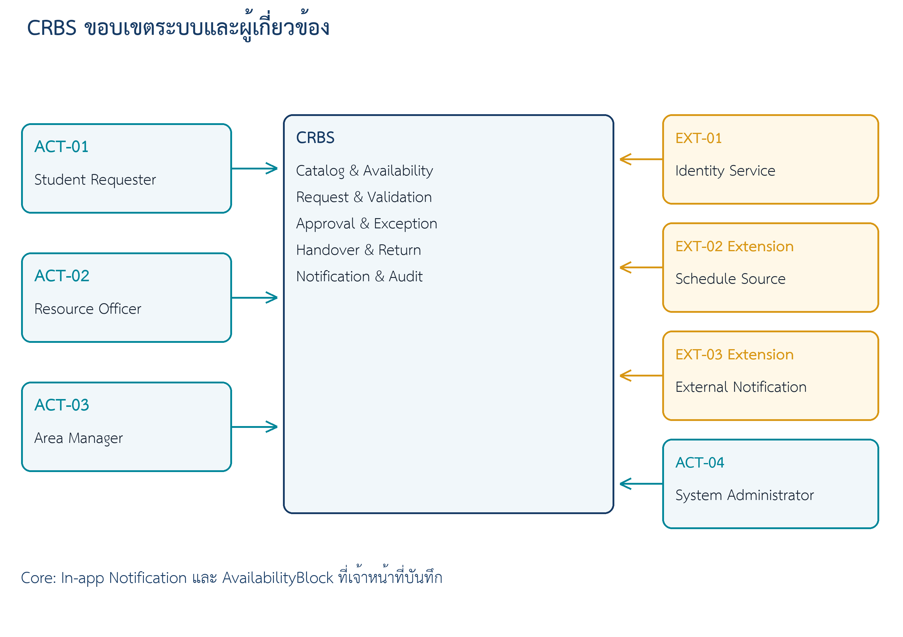
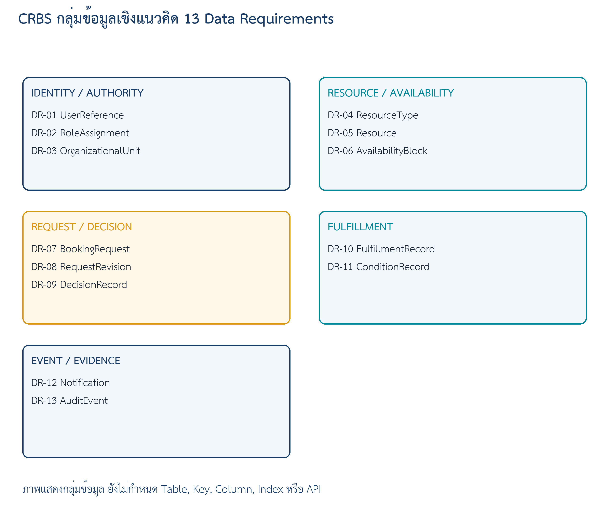
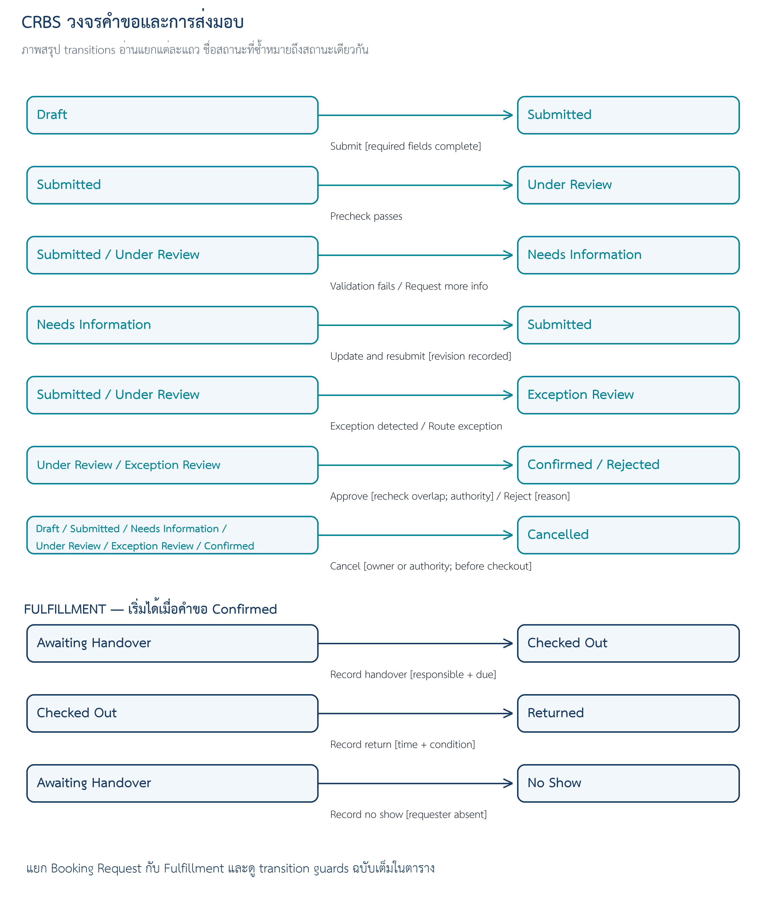

# 07 — Software Requirements Specification (SRS) v1

> **Week 7 deliverable** · Campus Resource Booking System (CRBS)  
> Document ID: `CRBS-SRS-W07-v1.1` | เวอร์ชัน: v1.1 | สถานะ: **Baseline Candidate** — ยังไม่ใช่ baseline ที่ได้รับอนุมัติ | วันที่: 13/09/2026

## Document Control

| Version | Date | Author | Reviewer | Summary of Change |
|---|---|---|---|---|
| 0.1 | 09/09/2026 | วรินทร์ | — | ร่างแรก: หัวข้อ 1–6 และ Open Issues จาก `docs/05` (tag `baseline-v1.0`) และ `docs/06` |
| 1.0 | 11/09/2026 | ณัฐพล | ชลิตา (ตรวจภายใน 12/09/2026) | เพิ่มภาพ context / lifecycle / conceptual data map (แบบจากชุดตัวอย่างของผู้สอน), ตาราง state transition (7.1), Verification Plan (10) และ Traceability and Coverage (11) |
| 1.1 | 13/09/2026 | ปวีณา | ชลิตา, วรินทร์ (Review Gate 13/09/2026) | Baseline Candidate: เพิ่มบัญชีรับเข้า W06 แบบแจกแจงรหัส (7.2), Appendix A Requirement Disposition, Review Record (9) และ AI Use Disclosure (Appendix B) |

| Field | Value |
|---|---|
| Case | CRBS — Campus Resource Booking (Case X, teaching case) |
| W05 source | `docs/05-requirement-backlog.md` — 15 FR / 10 BR / 8 NFR / 13 DR |
| W06 source | `docs/06-requirement-models.md` — 12 US / 10 UC / 24 AC |
| Status | Baseline Candidate — ยังไม่ใช่ baseline ที่ได้รับอนุมัติ (รอ validation ใน W08) |

## 1. Introduction

### 1.1 Purpose

SRS นี้รวม Requirement Backlog (W05) และ Requirement Model (W06) เป็น specification ที่ตรวจ trace ได้ และใช้เป็น input ของ architecture, UX/UI, database และ low-level design ในสัปดาห์หลัง โดยยังไม่ถือเป็น baseline ที่ได้รับอนุมัติ จนกว่าผู้มีอำนาจจะมี decision record

| Goal | Outcome | Source | Status |
|---|---|---|---|
| G-01 | ผู้ขอใช้ตรวจทรัพยากรและช่วงเวลาว่างก่อนสร้างคำขอได้ | Teaching baseline | Accepted for case |
| G-02 | คำขอมีข้อมูลและสถานะที่ผู้เกี่ยวข้องเข้าใจตรงกัน | Teaching baseline | Accepted for case |
| G-03 | คำขอปกติและกรณีพิเศษไปถึงผู้มีอำนาจที่เหมาะสม | TD-05, TD-06 | Accepted for case |
| G-04 | ลดความเสี่ยงจาก Confirmed booking ทับซ้อน | TD-08–TD-10 | Accepted for case |
| G-05 | ติดตามผู้รับผิดชอบ การส่งมอบ การรับคืน และสภาพได้ | TD-12–TD-14 | Accepted for case |
| G-06 | เหตุการณ์และการตัดสินใจสำคัญตรวจสอบย้อนหลังได้ | TD-17 | Accepted for case |
| G-07 | ใช้ข้อมูลส่วนบุคคลเท่าที่จำเป็นต่อสิทธิ์และความรับผิดชอบ | TD-18 | Accepted for case |

### 1.2 Scope

- **Core / Supporting:** catalog/availability, Draft/Submit, validation/conflict, standard review, tracking/cancel, handover/return, manual AvailabilityBlock, in-app notification และ audit
- **Extension / Out:** exception path ใน Student Core, live schedule, external notification, payment/penalty, full maintenance, IoT, multi-campus/multi-resource และ AI decision
- ขนาดของ SRS: 15 FR / 10 BR / 8 NFR / 13 DR และอ้าง 12 US / 10 UC / 24 AC จาก W06

### 1.3 Definitions, Acronyms and Abbreviations

ดู [Glossary](glossary.md) — คำที่ SRS นี้ใช้บ่อย:

| คำ | ความหมายใน SRS นี้ | ที่มา |
|---|---|---|
| Booking Request State | Draft, Submitted, Needs Information, Under Review, Exception Review, Confirmed, Rejected, Cancelled | Request Lifecycle |
| Fulfillment State | Awaiting Handover, Checked Out, Returned, No Show — ใช้เฉพาะคำขอ Confirmed ที่ต้องส่งมอบ | Request Lifecycle |
| Confirmed | สถานะเดียวที่กัน Resource | BR-06 / TD-08 |
| AvailabilityBlock | ช่วงเวลาที่ Resource ไม่เปิดให้คำขอปกติ มี source และ reason | DR-06 / TD-16 |
| `TD-*` | Authorized Teaching Decision ของ CRBS — กติกาเพื่อการสอน ไม่ใช่นโยบายจริงของมหาวิทยาลัย | Teaching Case Decisions (`docs/05` หัวข้อ 1.2) |
| Partial | มี model ระดับ Summary หรือยังไม่มี AC เฉพาะ ต้องระบุ verification gap | `docs/06` หัวข้อ 7 |
| Extension | อยู่ใน SRS เพื่อแสดง boundary และ authority แต่ไม่ใช่ Core | `docs/05` |
| TBD | ค่าที่ยังไม่มีแหล่งอ้างอิง — ห้ามเติมเอง ต้องมี Open Issue (หัวข้อ 8) | — |

### 1.4 References

- [`CASE_CARD.md`](../CASE_CARD.md) — CRBS teaching case
- [`docs/04-evidence-log.md`](04-evidence-log.md) — E-01–E-06 → N-01–N-05
- [`docs/04-requirement-candidates.md`](04-requirement-candidates.md) — RC-01–RC-05
- [`docs/05-requirement-backlog.md`](05-requirement-backlog.md) — FR / BR / NFR / DR ที่ล็อกใน tag `baseline-v1.0`
- [`docs/06-requirement-models.md`](06-requirement-models.md) — US / UC / AC และ coverage
- CRBS Teaching Case Decisions `TD-01`–`TD-18` และ Request Lifecycle จาก CRBS Teaching Baseline v1.0-draft — เอกสารกรณีสอนของผู้สอน (แจกในชั้น ไม่อยู่ใน course repo) · ข้อความ TD ทั้ง 18 ข้อคัดไว้ใน [`docs/05`](05-requirement-backlog.md) หัวข้อ 1.2 และสถานะ / transition สรุปไว้ในหัวข้อ 7.1
- Course: [W07 assignment contract](https://github.com/se-rmutl/engse206-lab/blob/main/weeks/week-07-srs-authoring/assignment-contract.md)

## 2. Overall Description

### 2.1 Product Perspective

CRBS เป็นระบบใหม่ที่รวมการค้นหา การขอใช้ การพิจารณา และการส่งมอบ/รับคืนห้องและอุปกรณ์ไว้ในที่เดียว ผู้ใช้ 4 บทบาท (ACT-01–ACT-04) ทำงานกับระบบโดยตรง และมีระบบภายนอก 3 ระบบ: EXT-01 Identity Service (Core boundary assumption), EXT-02 Schedule Source และ EXT-03 External Notification (Extension) — ใน Core ใช้ in-app notification และ AvailabilityBlock ที่เจ้าหน้าที่บันทึก

Source: [`w07-crbs-system-context.drawio`](../diagrams/context/w07-crbs-system-context.drawio)

| CAP | Capability | Anchors |
|---|---|---|
| CAP-01 | Resource Catalog and Availability | FR-01/02/11; DR-04–07 |
| CAP-02 | Booking Request | FR-03/04; BR-01–03; DR-07/08 |
| CAP-03 | Validation and Conflict Control | FR-04/06; BR-03/06/07; NFR-04 |
| CAP-04 | Approval and Exception | FR-06/07; BR-04/05/08; DR-09 |
| CAP-05 | Request Tracking and Cancellation | FR-05/08; BR-09; DR-08/12/13 |
| CAP-06 | Handover and Return | FR-12–14; BR-10; DR-10/11 |
| CAP-07 | Notification and Audit | FR-09/15; NFR-01–03/08; DR-12/13 |
| CAP-08 | Resource Administration | FR-10/11; NFR-02; DR-02–06 |

### 2.2 User Classes and Characteristics

| Actor | Role | Authorized actions | Restrictions |
|---|---|---|---|
| ACT-01 | Student Requester | ค้นหา สร้าง/ส่ง/ติดตาม/ยกเลิกคำขอของตน และให้ข้อมูลเพิ่ม | ไม่อนุมัติ ไม่แก้ Resource และไม่เห็นคำขอคนอื่น |
| ACT-02 | Resource Officer | ดูแล Resource/AvailabilityBlock ตัดสิน standard request และบันทึก handover/return | ไม่ตัดสิน exception แทน Area Manager |
| ACT-03 | Area Manager | ตัดสิน exception พร้อม rationale | ห้าม bypass overlap guard และเห็นข้อมูลเท่าที่จำเป็น |
| ACT-04 | System Administrator | จัดการ role mapping/configuration และดูผล audit ตามสิทธิ์ | ไม่แก้ business decision หรือ booking policy |

> "Authorized Staff" ใน `docs/06` (US-12, UC-10) คือ role abstraction ภายใต้ NFR-02 ไม่ใช่ actor ใหม่

### 2.3 Operating Environment

SRS นี้ตั้งใจไม่กำหนด platform, อุปกรณ์ หรือ hosting เพราะเป็น design decision ของ W10–W11 สิ่งที่กำหนดแล้วมีเพียง:

- identity มาจาก EXT-01 Institutional Identity Service — protocol, fields และ failure behavior ยัง TBD (OI-03)
- notification ใน Core เป็น in-app (FR-09); external channel เป็น Extension (EXT-03, OI-05)
- flow หลักของ Core ต้องทำจนจบได้ด้วย keyboard อย่างเดียว (NFR-06)

### 2.4 Constraints

- หนึ่ง Booking Request อ้าง Resource หนึ่งรายการและหนึ่งช่วงเวลา (BR-01)
- ไม่เก็บ password หรือเลขบัตรประชาชน (NFR-01, DR-01)
- Core ไม่มี payment/penalty — no-show บันทึกเป็นเหตุการณ์เท่านั้น (FR-14)
- schedule integration เป็น Extension — Core ใช้ AvailabilityBlock ที่บันทึกด้วยมือ (EXT-02, OI-04)
- กติกา `TD-*` เป็น Authorized Teaching Decision — ห้ามอ้างว่าเป็นนโยบายจริงหรือผลสัมภาษณ์ stakeholder

### 2.5 Assumptions and Dependencies

- EXT-01 Identity Service ส่ง user reference, display identity และ role claim ได้ (Core boundary assumption — OI-03)
- ค่า performance target, retention, RPO/RTO และ log retention ขึ้นกับ OI-01 และ OI-02 — SRS ไม่ฝังตัวเลข
- UC-05 (exception) เป็น Extension แต่คงไว้เพื่อแสดง boundary และ authority
- กลไก concurrency ที่ทำให้ NFR-04 เป็นจริงเป็น design decision (VF-04) ไม่ใช่ข้อกำหนดใน SRS

## 3. Functional Requirements

> สรุปจาก `05-requirement-backlog.md` และคง ID เดิม · คอลัมน์ Acceptance อ้าง model ใน `docs/06`

| ID | Requirement | Source | Priority / Admission | Acceptance / Verification (W06 model) | Status |
|---|---|---|---|---|---|
| FR-01 | ระบบต้องให้ Requester ค้นหาทรัพยากรตามประเภท วัน และช่วงเวลาได้ | F-01–F-03; E-01, E-02 → N-01, N-02 → RC-01, RC-02; TD-01/16 | Must / Core | US-01; UC-01; AC-01–AC-04 | Detailed; Ready for Modeling |
| FR-02 | ระบบต้องแสดงรายละเอียด สถานะ และเงื่อนไขที่มีแหล่งอ้างอิงของทรัพยากรแต่ละรายการ | E-01, E-02 → N-01 → RC-01; OQ-08; TD-16 | Must / Core | US-02; UC-01; AC-01, AC-03 | Detailed; Ready with TBD |
| FR-03 | ระบบต้องให้ Requester สร้าง แก้ไข และยุติ Draft request ของตนได้ | E-04 → N-04; TD-01–03 | Must / Core | US-03; UC-02; AC-08 | Detailed; Ready for Modeling |
| FR-04 | ระบบต้องให้ Requester ส่งคำขอที่มีข้อมูลขั้นต่ำและรับเลขอ้างอิงคำขอได้ | E-04 → N-04 → RC-04; TD-03/04 | Must / Core | US-04; UC-02; AC-05–AC-07 | Detailed; Ready for Modeling |
| FR-05 | ระบบต้องให้ Requester ดูสถานะและประวัติคำขอ รวมทั้งส่งข้อมูลเพิ่มเมื่อถูกร้องขอได้ | E-04 (ถ้าข้อมูลไม่ครบต้องถามกลับ) → N-04; TD-07/15/17 · ส่วนดูสถานะ/ประวัติไม่มี E-ID (trace gap OQ-13) | Must / Core | US-05/06; UC-03; cross-cutting | Partial; Ready for Modeling |
| FR-06 | ระบบต้องให้ Resource Officer ตรวจและตัดสิน standard request เป็น Confirmed, Rejected หรือ Needs Information พร้อมเหตุผลตามกติกา | E-04 → N-04; TD-05/07–10 | Must / Core | US-08; UC-04; AC-09–AC-12 | Detailed; Ready for Modeling |
| FR-07 | ระบบต้องส่ง exception request ให้ Area Manager และบันทึกผลพร้อมเหตุผล | E-05 → N-05 → RC-05; OQ-01; TD-06/07 | Should / Extension | US-09; UC-05; AC-13–AC-16 | Detailed / Extension; Extension Ready |
| FR-08 | ระบบต้องให้ Requester ยกเลิกคำขอของตนในสถานะที่อนุญาตและบันทึกเหตุผลเมื่อจำเป็น | OQ-03; TD-11/17 | Should / Core | US-07; UC-06; — | Partial; Ready for Modeling |
| FR-09 | ระบบต้องสร้าง in-app notification เมื่อเกิดเหตุการณ์สำคัญที่กำหนด | E-03 → N-03 (follow-up การแจ้งเตือน); OQ-05; TD-15 | Should / Supporting | supporting; UC-03/04/05/07/08; ไม่มี AC เฉพาะ — notification อยู่ใน Then ของ AC-10, AC-14, AC-15, AC-21 เท่านั้น · ตรวจด้วย review / inspection เทียบรายการเหตุการณ์ใน TD-15 · gap: การตัดสินใน AC-09, AC-11, AC-13, การยกเลิก, Check Out (AC-17) และ No Show (AC-19) ยังไม่มี AC ที่ตรวจ notification | Cross-cutting / Partial; Ready with TBD |
| FR-10 | ระบบต้องให้ Resource Officer จัดการข้อมูลและ lifecycle status ของ Resource ในหน่วยงาน | F-01; CT-01, CT-05; TD-16 | Should / Extension | —; UC-09; — | Partial / Extension; Extension Ready |
| FR-11 | ระบบต้องให้ Resource Officer สร้าง แก้ไข หรือยกเลิก AvailabilityBlock พร้อม source และ reason | E-05 (ชนตารางเรียน); OQ-08; TD-16 | Must / Supporting | —; UC-01/04/09; AC-03, AC-07 | Supporting; Ready for Modeling |
| FR-12 | ระบบต้องให้ Resource Officer บันทึกการส่งมอบอุปกรณ์ให้ responsible requester พร้อมเวลาและกำหนดคืน | F-04; E-03 → N-03 → RC-03; TD-12 | Must / Core | US-10; UC-07; AC-17–AC-20 | Detailed; Ready for Modeling |
| FR-13 | ระบบต้องให้ Resource Officer บันทึกการรับคืน เวลา และ condition summary ของอุปกรณ์ | F-04; E-03 → N-03; OQ-04; TD-13 | Must / Core | US-11; UC-08; AC-21–AC-24 | Detailed; Ready for Modeling |
| FR-14 | ระบบต้องให้ Resource Officer บันทึก no-show event โดยไม่คำนวณค่าปรับใน Core | OQ-03; TD-14 | Could / Extension | —; UC-07 ALT-15; AC-19 | Extension; Extension Ready |
| FR-15 | ระบบต้องให้บทบาทที่ได้รับสิทธิ์ดู request history และ audit events ที่เกี่ยวข้องได้ | F-02, F-03; TD-17 | Should / Core | US-12; UC-10; cross-cutting | Partial; Ready with TBD |

## 4. Non-functional Requirements

| ID | Quality Attribute | Requirement | Scenario | Measure | Verification | Status |
|---|---|---|---|---|---|---|
| NFR-01 | Privacy (data minimization) | ระบบต้องเก็บ user data เท่าที่จำเป็นและไม่เก็บ password หรือเลขบัตรประชาชน | เมื่อมีการออกแบบ/เปลี่ยนข้อมูลผู้ใช้ ต้องตรวจ field inventory ว่าเก็บเฉพาะ external reference และ display data ที่จำเป็น | ไม่มี password/เลขบัตรประชาชน; sensitive fields มี justification | Inspection + privacy review | Ready |
| NFR-02 | Security (authorization) | ระบบต้องจำกัดการอ่านและการกระทำตาม role, unit scope และ ownership | เมื่อ actor อ่านหรือกระทำกับข้อมูล ระบบต้องตรวจ role, unit scope และ ownership | unauthorized action ถูกปฏิเสธและไม่เปิดเผยข้อมูลเกินสิทธิ์ | Authorization matrix + negative tests | Ready; matrix detail ใน OI-08 |
| NFR-03 | Auditability | การเปลี่ยนสถานะและ decision ต้องสร้าง audit event ที่มี actor, time, subject และ from/to state | เมื่อสถานะหรือ decision เปลี่ยน ต้องสร้าง AuditEvent | มี actor/time/subject/from-to/reason ตามกติกา | Record inspection | Ready |
| NFR-04 | Data integrity (concurrency) | การยืนยันคำขอพร้อมกันต้องไม่สร้าง Confirmed bookings ที่ทับซ้อนกัน | เมื่อมีการ approve resource/time เดียวกันพร้อมกัน | เกิด Confirmed ได้ไม่เกินหนึ่ง request | Concurrent scenario test | Ready; design mechanism TBD |
| NFR-05 | Performance | การค้นหาต้องตอบสนองในเวลาที่ผู้ใช้ยอมรับได้ภายใต้ workload ที่กำหนด | Requester ค้นหาภายใต้ workload ที่ตกลง | target, workload และ percentile = TBD | Performance test | Open — OI-01 |
| NFR-06 | Accessibility / Usability | Flow หลักของ Core (ค้นหา → ส่งคำขอ → ตัดสิน → ส่งมอบ/รับคืน) ต้องทำจนจบได้ด้วย keyboard อย่างเดียว และทุก input, สถานะ และ error message ต้องบอกสิ่งที่ผู้ใช้ต้องรู้เพื่อทำขั้นต่อไป | ผู้ใช้ทำ flow หลักแต่ละ flow ด้วย keyboard อย่างเดียว และพบ validation error | ผ่านเมื่อครบทุกข้อ: (1) ทำจนจบได้ด้วย keyboard อย่างเดียว (2) ทุก input มี label ที่มองเห็นได้ (3) สถานะปัจจุบันของคำขอแสดงเป็นข้อความ (4) ทุก error message ระบุ field หรือเงื่อนไขที่ไม่ผ่าน และสิ่งที่ผู้ใช้ต้องทำต่อ · ไม่ใส่เกณฑ์ตัวเลข | Walkthrough ทุก flow หลัก (ผ่าน / ไม่ผ่านตาม 4 ข้อ) · มาตรฐาน accessibility ที่จะอ้างอิงเพิ่ม = TBD (UX plan) | Ready (cross-cutting) |
| NFR-07 | Reliability (recoverability) | ระบบต้องป้องกันการสูญหายของ request, decision และ audit data ตาม recovery objective ที่กำหนด | เกิดเหตุขัดข้องที่กระทบ request/decision/audit data | RPO/RTO/backup policy = TBD | Backup/restore exercise | Open — OI-02 |
| NFR-08 | Observability + Privacy | ระบบต้องบันทึก operational error และ correlation reference โดยไม่เปิดเผยข้อมูลส่วนบุคคลเกินจำเป็น | เกิด operational error ใน request flow | มี correlation reference โดย log ไม่เปิด PII เกินจำเป็น; retention = TBD | Log inspection + failure scenario | Open — OI-02 |

## 5. External Interface Requirements

### 5.1 User Interfaces

SRS นี้ไม่ออกแบบหน้าจอ (UX/UI อยู่ใน W12) ข้อกำหนดที่มีผลต่อ UI แล้วคือ:

- NFR-06 — flow หลักของ Core ทำจนจบได้ด้วย keyboard อย่างเดียว · ทุก input มี label ที่มองเห็นได้ · สถานะคำขอแสดงเป็นข้อความ · error ระบุ field หรือเงื่อนไขที่ไม่ผ่านและสิ่งที่ต้องทำต่อ
- FR-09 — in-app notification เมื่อเกิดเหตุการณ์สำคัญที่กำหนด
- เมื่อข้อมูลไม่ครบ ระบบต้องระบุ field/เงื่อนไขที่ต้องแก้ (AC-04, AC-06, AC-18, AC-22)
- ไม่แสดงค่าที่ยังเป็น TBD ด้วยการเดา (UC-01 ALT-03) และไม่แสดง sensitive data เกิน role (UC-10)

### 5.2 Software / External System Interfaces

| ID | System | Data / direction | Scope | TBD |
|---|---|---|---|---|
| EXT-01 | Institutional Identity Service | เข้า: user reference, display identity, role claim | Core boundary assumption | protocol, failure behavior, field contract = TBD (OI-03) |
| EXT-02 | Class Schedule Source | เข้า: reserved time window และ source identity | Extension | format, frequency, reconciliation = TBD (OI-04) |
| EXT-03 | External Notification Channel | ออก: delivery request; เข้า: delivery result | Extension | channel, privacy, retry = TBD (OI-05) |

### 5.3 Data Interfaces

รายการนี้เป็น conceptual data requirement ไม่ใช่ physical schema

Source: [`w07-crbs-conceptual-data-map.drawio`](../diagrams/domain-model/w07-crbs-conceptual-data-map.drawio) — ภาพแสดงกลุ่มข้อมูล ยังไม่กำหนด table, key, column, index หรือ API

| ID | Concept | Requirement | Relationships | Classification | Source | W06 use |
|---|---|---|---|---|---|---|
| DR-01 | UserReference | ระบบต้องเก็บ external user reference และ display information เท่าที่จำเป็น โดยไม่เก็บ password หรือเลขบัตรประชาชน | มี RoleAssignment; เป็น requester/responsible/decision actor | Personal | TD-18; NFR-01 | ทุก UC ผ่าน actor identity |
| DR-02 | RoleAssignment | ระบบต้องเชื่อมผู้ใช้กับ role และ organizational unit เพื่อใช้ตรวจสิทธิ์และขอบเขตข้อมูล | UserReference ↔ Unit ↔ Role | Internal/Personal | ACT-01–04; NFR-02 | UC-04/05/09/10; Partial |
| DR-03 | OrganizationalUnit | ระบบต้องเก็บหน่วยงานหรืออาคารที่รับผิดชอบ Resource และขอบเขต Officer | หนึ่ง Unit มีหลาย Resource และ RoleAssignment | Reference/Internal | CT-01 | UC-01/04/09 |
| DR-04 | ResourceType | ระบบต้องเก็บประเภทห้องหรืออุปกรณ์เพื่อจัดกลุ่ม Resource และรองรับเงื่อนไขที่อาจต่างกัน | หนึ่ง ResourceType มีหลาย Resource | Public/Reference | CAP-01/08; F-01 | UC-01/09; AC-01 |
| DR-05 | Resource | ระบบต้องเก็บรหัส/ชื่อ ประเภท หน่วยงาน สถานที่ทั่วไป และ lifecycle status ของทรัพยากร | อยู่ใน Unit และ Type; มี Block/Request | Public/Reference + Internal status | FR-01/02/10; TD-16; A-02 | UC-01/02/04/07–09 |
| DR-06 | AvailabilityBlock | ระบบต้องเก็บ Resource, start, end, source, reason และผู้สร้างสำหรับช่วงที่ไม่เปิดให้คำขอปกติ | ผูก Resource; ใช้ค้นหาและ route exception | Internal | TD-06/16; FR-11 | UC-01/02/04/05/09; AC-03/07 |
| DR-07 | BookingRequest | ระบบต้องเก็บ requester reference, Resource, start, end, purpose, reference number และ request state | มี Revision/Decision; อาจมี Fulfillment | Personal/Internal | TD-01–04; RC-04 | UC-02–08/10 |
| DR-08 | RequestRevision | ระบบต้องเก็บ snapshot ของข้อมูลที่แก้ ผู้แก้ เวลา และบริบทเมื่อมีการส่งข้อมูลเพิ่ม | หลาย Revision ต่อหนึ่ง BookingRequest | Personal/Internal | FR-05; TD-07/17 | UC-03; Partial |
| DR-09 | DecisionRecord | ระบบต้องเก็บ request, decision type, actor, timestamp และ reason เมื่อกติกากำหนด | หลาย Decision ต่อหนึ่ง BookingRequest | Sensitive operational | TD-05–09 | UC-04/05/10; AC-09–16 |
| DR-10 | FulfillmentRecord | ระบบต้องเก็บ confirmed request, fulfillment state, responsible requester, checkout time, due time, returned time หรือ no-show event ตาม flow | ศูนย์หรือหนึ่ง record ต่อ BookingRequest | Personal/Internal | TD-12–14; BR-10 | UC-07/08; AC-17–24 |
| DR-11 | ConditionRecord | ระบบต้องเก็บ condition summary และ optional attachment reference โดยไม่บังคับรูปภาพ | หลาย ConditionRecord ต่อ FulfillmentRecord | Sensitive operational | TD-13; NFR-01 | UC-08; AC-21–24 |
| DR-12 | Notification | ระบบต้องเก็บ recipient, event/reference, message summary, created time และ read status สำหรับ in-app notification | หลาย Notification ต่อ UserReference/เหตุการณ์ | Personal/Internal | TD-15; FR-09 | UC-03/04/05/07/08; Partial |
| DR-13 | AuditEvent | ระบบต้องเก็บ actor, event, timestamp, affected subject, from/to state และ reason/context เมื่อกำหนด | หลาย AuditEvent ต่อ business subject | Sensitive operational | TD-17; NFR-03 | UC-02/04/05/07–10 |

## 6. Business Rules

| ID | Rule | Authority | Priority | Related Requirement | W06 evidence | Status |
|---|---|---|---|---|---|---|
| BR-01 | หนึ่ง Booking Request อ้าง Resource หนึ่งรายการและหนึ่งช่วงเวลา | TD-01 | Must | FR-03, FR-04 | UC-02; AC-05 | Authorized Teaching Rule |
| BR-02 | Draft ไม่กัน Resource และไม่เข้าสู่ review queue | TD-02 | Must | FR-03 | UC-02; AC-05, AC-08 | Authorized Teaching Rule |
| BR-03 | Submit ต้องมี Resource, Start, End และ Purpose และ Start ต้องก่อน End | TD-03 | Must | FR-04 | UC-02; AC-05, AC-06 | Authorized Teaching Rule |
| BR-04 | Standard request ถูกพิจารณาโดย Resource Officer | TD-05 | Must | FR-06 | UC-04; AC-09–AC-12 | Authorized Teaching Rule |
| BR-05 | Request ที่มี exception flag หรือชน AvailabilityBlock ถูกส่ง Area Manager | TD-06 | Should | FR-07, FR-11 | UC-02/05; AC-07, AC-13–AC-16 | Authorized Teaching Rule |
| BR-06 | เฉพาะ Confirmed request เท่านั้นที่กัน Resource | TD-08 | Must | FR-01, FR-04, FR-06, NFR-04 | UC-01/02/04; AC-02, AC-05, AC-09 | Authorized Teaching Rule |
| BR-07 | ก่อน Confirmed ต้องตรวจใหม่ว่าไม่มี Confirmed request ของ Resource เดียวกันในเวลาทับซ้อน | TD-09/10 | Must | FR-06, FR-07, NFR-04 | UC-01/04/05; AC-02, AC-09, AC-12, AC-13, AC-16 | Authorized Teaching Rule |
| BR-08 | Rejected, Needs Information และ Exception Decision ต้องมี reason | TD-07 | Must | FR-05, FR-06, FR-07 | UC-04/05; AC-10, AC-11, AC-14, AC-15 | Authorized Teaching Rule |
| BR-09 | Confirmed request ยกเลิกได้ก่อน Check Out และต้องมี cancellation reason | TD-11 | Should | FR-08 | UC-06; Partial | Authorized Teaching Rule |
| BR-10 | Check Out ต้องมี responsible requester และ due time; Return ต้องมี returned time และ condition summary | TD-12/13 | Must | FR-12, FR-13 | UC-07/08; AC-17–AC-24 | Authorized Teaching Rule |

## 7. Requirement Models

- User Stories / Use Cases / Acceptance Criteria: [`docs/06-requirement-models.md`](06-requirement-models.md) — US-01–US-12, UC-01–UC-10 (Detailed 6, Summary/Supporting 4), AC-01–AC-24 ใช้เป็น verification specification
- Use Case Diagram: [w06-use-case-overview.png](../diagrams/use-case/w06-use-case-overview.png)
- Activity Diagram: [w06-submit-review-activity.png](../diagrams/activity/w06-submit-review-activity.png) — Submit → precheck → standard review → Confirmed / Rejected
- Request Lifecycle: [w07-crbs-lifecycle.png](../diagrams/activity/w07-crbs-lifecycle.png) — แยก Booking Request State กับ Fulfillment State
- Domain Model (conceptual data map): [w07-crbs-conceptual-data-map.png](../diagrams/domain-model/w07-crbs-conceptual-data-map.png)
- CAP-05 / CAP-07 / CAP-08 คง Partial; UC-05 คง Extension

### 7.1 Request Lifecycle — State Transitions

| From | Trigger [guard] | To | Source |
|---|---|---|---|
| Draft | submit [required data valid] | Submitted | BR-02/03; FR-04 |
| Submitted | precheck [standard] | Under Review | TD-04; FR-04 |
| Submitted | precheck [exception/block] | Exception Review | BR-05; FR-07 |
| Under Review | approve [recheck passes] | Confirmed | BR-06/07; NFR-04 |
| Under Review | request more information [reason] | Needs Information | BR-08; FR-05/06 |
| Needs Information | resubmit | Submitted | FR-05; DR-08 |
| Under Review / Exception Review | reject [reason] | Rejected | BR-08 |
| Exception Review | approve [recheck passes] | Confirmed | BR-05/07 |
| Eligible request | cancel [guard; reason when Confirmed] | Cancelled | BR-09; FR-08 |
| Awaiting Handover | check out [responsible + due] | Checked Out | BR-10; FR-12 |
| Checked Out | return [returned time + condition] | Returned | BR-10; FR-13 |
| Awaiting Handover | record no-show | No Show | FR-14; no penalty |

> ตารางนี้สรุป transition หลัก — alternate flow อื่นอยู่ใน `docs/06` (เช่น UC-02 Step 7 ที่ precheck ส่งไป Needs Information และ UC-04 ALT-09 ที่ Officer ส่งต่อ Exception Review) · Rejected และ Cancelled เป็น terminal state ของ request รุ่นนั้น · automatic expiration, เวลาตัดสิน no-show และ locking strategy ยังไม่ตัดสิน (TBD)

### 7.2 บัญชีรับเข้า W06 แบบแจกแจงรหัส

- US: US-01, US-02, US-03, US-04, US-05, US-06, US-07, US-08, US-09, US-10, US-11, US-12
- UC: UC-01, UC-02, UC-03, UC-04, UC-05, UC-06, UC-07, UC-08, UC-09, UC-10
- AC: AC-01, AC-02, AC-03, AC-04, AC-05, AC-06, AC-07, AC-08, AC-09, AC-10, AC-11, AC-12, AC-13, AC-14, AC-15, AC-16, AC-17, AC-18, AC-19, AC-20, AC-21, AC-22, AC-23, AC-24

## 8. Open Issues

| ID | Issue / Question (TBD) | Source OQ (`docs/05`) | Affected IDs | Owner | ผู้ติดตามในทีม | Next action / evidence | Due / Status |
|---|---|---|---|---|---|---|---|
| OI-01 | Performance target, workload และ percentile | OQ-09 | NFR-05 | Product Owner / Instructor | ชลิตา | เก็บ workload fixture และ accepted target | ก่อน Performance plan · Open |
| OI-02 | Retention, RPO/RTO และ backup/restore | OQ-10 | NFR-01/03/07/08; DR-07/09/13 | Data/Operations reviewer | ณัฐพล | นโยบาย retention + recovery evidence | ก่อน Architecture/Data design · Open |
| OI-03 | Identity fields, protocol และ failure behavior | OQ-11 | NFR-01/02; DR-01/02; EXT-01 | Security/Interface reviewer | ณัฐพล | Identity contract | ก่อน Interface design · Open |
| OI-04 | Schedule source integration | OQ-12 | FR-07/11; DR-06; EXT-02 | Product Owner | ชลิตา | Interface decision; Core ใช้ manual block ต่อ | ก่อน Integration design · Open |
| OI-05 | External notification channel | OQ-05 (ส่วนช่องทางภายนอก) | FR-09; DR-12; EXT-03 | Product Owner | วรินทร์ | Channel/privacy/delivery contract | ก่อน Extension design · Open |
| OI-06 | No-show timing และ penalty policy | OQ-03 (ส่วนเวลาที่ถือว่า no-show) | FR-14; DR-10 | Policy owner | ชลิตา | Policy evidence; Core ไม่มี penalty | ก่อน Policy validation · Open |
| OI-07 | Detailed flows/AC สำหรับ UC-03/06/09/10 | — (ใหม่ใน W06) | FR-05/08/10/11/15 | Requirements team | ปวีณา | Model review และเพิ่ม AC เมื่อ admitted | ก่อน Feature baseline · Open |
| OI-08 | Role-action และ audit data visibility | OQ-13 (บางส่วน — NFR-02/NFR-03 ยังไม่มี E-ID) | NFR-02; FR-15; DR-02/13 | Security/Requirements reviewer | ปวีณา | Authorization matrix + negative scenarios | ก่อน SRS validation · Open |

> OQ ใน `docs/05` ที่ไม่ได้ตั้งเป็น OI แยก: OQ-02, OQ-07 (จองล่วงหน้า / ระยะเวลาสูงสุด / โควตา — SRS ไม่กำหนดค่า) · OQ-13 trace gap — Must ที่ trace ไป authority อย่างเดียว (NFR-01–NFR-03, BR-01, BR-02, BR-08) และบางส่วน (FR-05 ส่วนดูสถานะ/ประวัติ, BR-04) (ติดตามใน W08) · OQ-14 (scope gap จาก W02 — รอผู้สอนยืนยัน)

## 9. Approval / Review Record

| Reviewer | Date | Result | Key Feedback |
|---|---|---|---|
| ชลิตา (Evidence & Scope Analyst) — ตรวจภายใน v1.0 | 12/09/2026 | Revision | ให้แจกแจง US/UC/AC ที่รับเข้าจาก W06 แบบนับได้ และทำ disposition ครบทุก FR/BR/NFR/DR (บันทึกใน [`evidence/week-07/`](../evidence/week-07/README.md)) |
| ชลิตา + วรินทร์ — Review Gate v1.1 | 13/09/2026 | PASS — Baseline Candidate (ไม่ใช่การอนุมัติ) | 15 FR / 10 BR / 8 NFR / 13 DR มี disposition · 12 US / 10 UC / 24 AC trace กลับได้ · Partial / Extension / TBD คงอยู่ · OI-01–OI-08 มี owner / action / evidence |
| ผู้สอน / Product Owner | — | ยังไม่ได้ตัดสิน | ยังไม่มี decision record — SRS คงสถานะ Baseline Candidate และรอ validation / traceability ใน W08 |

## 10. Verification Plan

| VF | Method | Target | Procedure / evidence | Owner |
|---|---|---|---|---|
| VF-01 | Review | FR/BR/NFR/DR ทุกข้อมี source, status และ disposition | SRS review checklist + trace matrix | Requirements reviewer |
| VF-02 | Demonstration | UC-01/02/04/07/08 main flow ทำได้ตาม AC | Prototype or scripted walkthrough | Product / Instructor |
| VF-03 | Test | Validation, authorization, conflict และ state guards | AC-02, AC-04, AC-06, AC-08, AC-12, AC-16, AC-18, AC-20, AC-22, AC-23 | QA / Developers |
| VF-04 | Analysis | Concurrency design รองรับ NFR-04 | Design reasoning + race scenario | Architect / Developers |
| VF-05 | Inspection | DR-01–13 และ privacy classification สอดคล้องกับ data flow | Data inventory + conceptual model | Data / Security reviewer |
| VF-06 | Open evidence | NFR-05/07/08 และ interfaces มี owner/evidence plan | OI register (หัวข้อ 8) | Instructor / Product owner |

## 11. Traceability and Coverage

| CAP | Capability | W05 anchors | W06 model | Coverage |
|---|---|---|---|---|
| CAP-01 | Resource Catalog and Availability | FR-01/02/11; DR-04–07 | UC-01 | Detailed |
| CAP-02 | Booking Request | FR-03/04; BR-01–03; DR-07/08 | UC-02 | Detailed |
| CAP-03 | Validation and Conflict Control | FR-04/06; BR-03/06/07; NFR-04 | UC-02/04 | Detailed |
| CAP-04 | Approval and Exception | FR-06/07; BR-04/05/08; DR-09 | UC-04/05 | Detailed; UC-05 Extension |
| CAP-05 | Request Tracking and Cancellation | FR-05/08; BR-09; DR-08/12/13 | UC-03/06 | Partial |
| CAP-06 | Handover and Return | FR-12–14; BR-10; DR-10/11 | UC-07/08 | Detailed |
| CAP-07 | Notification and Audit | FR-09/15; NFR-01–03/08; DR-12/13 | UC-10 + events | Partial / Cross-cutting |
| CAP-08 | Resource Administration | FR-10/11; NFR-02; DR-02–06 | UC-09 | Partial / Extension |

> Traceability matrix แบบเดินไปและกลับ (evidence → need → requirement → model → verification) ทำต่อใน W08 ที่ `docs/08-validation-traceability.md` ส่วน B

## Appendix A — Requirement Disposition

| ID | Disposition | SRS | Reason / status |
|---|---|---|---|
| FR-01 | Included | หัวข้อ 3 | CAP-01; Detailed |
| FR-02 | Issue/Partial | หัวข้อ 3 | CAP-01; Detailed |
| FR-03 | Included | หัวข้อ 3 | CAP-02; Detailed |
| FR-04 | Included | หัวข้อ 3 | CAP-02/03; Detailed |
| FR-05 | Issue/Partial | หัวข้อ 3 | CAP-05/07; Partial |
| FR-06 | Included | หัวข้อ 3 | CAP-03/04; Detailed |
| FR-07 | Extension | หัวข้อ 3 | CAP-04; Detailed/Extension |
| FR-08 | Issue/Partial | หัวข้อ 3 | CAP-05; Partial |
| FR-09 | Issue/Partial | หัวข้อ 3 | CAP-07; Cross-cutting / Partial — ไม่มี AC เฉพาะ |
| FR-10 | Extension | หัวข้อ 3 | CAP-08; Partial/Extension |
| FR-11 | Included | หัวข้อ 3 | CAP-01/08; Supporting |
| FR-12 | Included | หัวข้อ 3 | CAP-06; Detailed |
| FR-13 | Included | หัวข้อ 3 | CAP-06; Detailed |
| FR-14 | Extension | หัวข้อ 3 | CAP-06/07; Extension |
| FR-15 | Issue/Partial | หัวข้อ 3 | CAP-07; Partial |
| BR-01 | Included | หัวข้อ 6 | Authorized Teaching Rule; Detailed |
| BR-02 | Included | หัวข้อ 6 | Authorized Teaching Rule; Detailed |
| BR-03 | Included | หัวข้อ 6 | Authorized Teaching Rule; Detailed |
| BR-04 | Included | หัวข้อ 6 | Authorized Teaching Rule; Detailed |
| BR-05 | Extension | หัวข้อ 6 | Authorized Teaching Rule; Detailed/Extension |
| BR-06 | Included | หัวข้อ 6 | Authorized Teaching Rule; Detailed |
| BR-07 | Included | หัวข้อ 6 | Authorized Teaching Rule; Detailed |
| BR-08 | Included | หัวข้อ 6 | Authorized Teaching Rule; Detailed |
| BR-09 | Issue/Partial | หัวข้อ 6 | Authorized Teaching Rule; Partial |
| BR-10 | Included | หัวข้อ 6 | Authorized Teaching Rule; Detailed |
| NFR-01 | Included | หัวข้อ 4 | Cross-cutting/Partial |
| NFR-02 | Included | หัวข้อ 4 | Cross-cutting/Partial |
| NFR-03 | Included | หัวข้อ 4 | Detailed/Cross-cutting |
| NFR-04 | Included | หัวข้อ 4 | Detailed |
| NFR-05 | Issue/TBD | หัวข้อ 4 | TBD |
| NFR-06 | Included | หัวข้อ 4 | Cross-cutting; walkthrough 4 ข้อ · มาตรฐานอ้างอิงเพิ่ม TBD |
| NFR-07 | Issue/TBD | หัวข้อ 4 | TBD |
| NFR-08 | Issue/TBD | หัวข้อ 4 | TBD |
| DR-01 | Included | หัวข้อ 5.3 | UserReference; Supporting |
| DR-02 | Issue/Partial | หัวข้อ 5.3 | RoleAssignment; Partial |
| DR-03 | Included | หัวข้อ 5.3 | OrganizationalUnit; Supporting |
| DR-04 | Included | หัวข้อ 5.3 | ResourceType; Detailed/Supporting |
| DR-05 | Included | หัวข้อ 5.3 | Resource; Detailed |
| DR-06 | Included | หัวข้อ 5.3 | AvailabilityBlock; Detailed/Supporting |
| DR-07 | Included | หัวข้อ 5.3 | BookingRequest; Detailed |
| DR-08 | Issue/Partial | หัวข้อ 5.3 | RequestRevision; Partial |
| DR-09 | Included | หัวข้อ 5.3 | DecisionRecord; Detailed |
| DR-10 | Included | หัวข้อ 5.3 | FulfillmentRecord; Detailed |
| DR-11 | Included | หัวข้อ 5.3 | ConditionRecord; Detailed |
| DR-12 | Issue/Partial | หัวข้อ 5.3 | Notification; Cross-cutting/Partial |
| DR-13 | Included | หัวข้อ 5.3 | AuditEvent; Cross-cutting |

## Appendix B — AI Use Disclosure

ทีมใช้ Claude (claude.ai) ช่วยจัดโครงตารางและตรวจว่า ID ที่อ้างใน SRS มีอยู่จริงใน `docs/05` และ `docs/06` (รายละเอียดใน [`project-management/ai-use-log.md`](../project-management/ai-use-log.md)) สมาชิกตรวจทุกแถวเทียบไฟล์ต้นทางเอง · ภาพ context, lifecycle และ conceptual data map เป็นแบบจากชุดตัวอย่างของผู้สอน (แจกในชั้น) — ณัฐพลตรวจชื่อ actor / EXT / สถานะ / กลุ่ม DR ในภาพเทียบ ID ของ SRS · กติกา `TD-*` ผู้สอนเป็นผู้ยืนยันในฐานะ Teaching Baseline และต้อง review ก่อนประกาศ baseline
